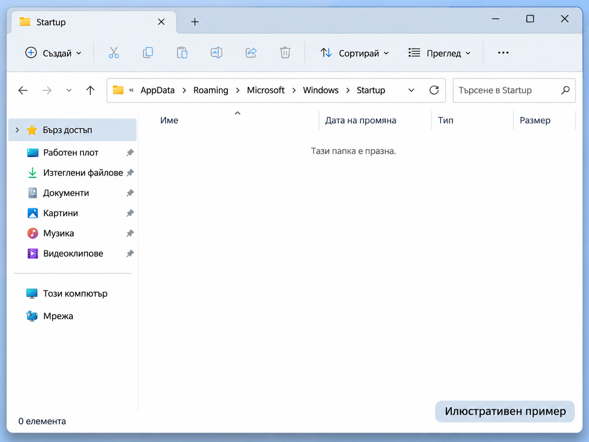
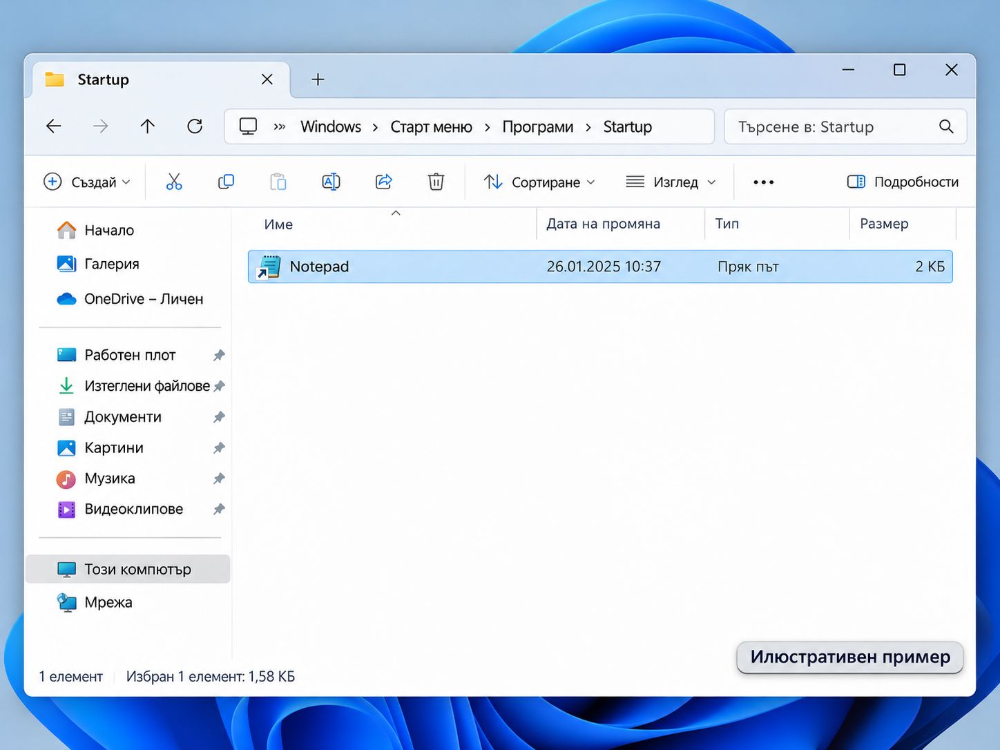

+++
title = "Как да стартираме програма автоматично с Windows чрез една команда?"
slug = "avtomatichno-startirane-programi-windows"
date = "2026-11-17T18:30:00.000+02:00"
author = "4s"
draft = true
description = "Научете как да стартирате програма автоматично при влизане в Windows 10 и 11 с командата shell:startup. Добавяне и премахване на приложения от Startup."
tags = ["Windows 11", "Windows 10", "Startup", "shell:startup", "Автоматично стартиране", "Програми", "Настройки"]
coverImg = "windows-run-dialog-and-folder-icon.png"
+++
Искате определена програма да се отваря автоматично всеки път, когато влезете в Windows?

Може да го направите без допълнителен софтуер. Windows 10 и 11 разполагат със специална папка **Startup**, в която можем да добавяме преки пътища към приложенията, които използваме ежедневно.

### 1. Как да отворим папката Startup?

Натиснете **Win + R**, за да отворите прозореца Run.

Въведете командата:

`shell:startup`

Натиснете **Enter**.

Ще се отвори папката **Startup** във File Explorer.

Тя съдържа преки пътища към програми, които Windows може да стартира автоматично при влизане в текущия потребителски профил.

Ако папката е празна, това е напълно нормално.

### 2. Как да добавим програма?

Най-лесният начин е да добавите пряк път към желаното приложение.

Например, ако искате **Notepad** да се отваря автоматично, намерете неговия пряк път и го копирайте в папката Startup.

Ако не можете да откриете подходящ пряк път, натиснете **Win + R** и изпълнете:

`shell:appsfolder`

Ще се отвори списък с инсталираните приложения. Оттам можете да създадете пряк път или да го плъзнете към отворената папка Startup.

При следващото влизане в Windows програмата би трябвало да се стартира автоматично.

**Важно:** Поставяйте преки пътища, а не премествайте оригиналните файлове на програмите.

### 3. Как да премахнем програма от автоматичното стартиране?

Отворете отново:

`shell:startup`

Намерете прекия път на приложението и го изтрийте.

Това няма да деинсталира програмата. Просто ще премахне автоматичното ѝ стартиране чрез тази папка.

Ако програмата продължава да се стартира, проверете и **Task Manager → Startup apps**.

Можете да отворите Task Manager с клавишната комбинация **Ctrl + Shift + Esc**.

В този раздел се показват и приложения, които използват други механизми за автоматично стартиране.

### 4. Каква е разликата между shell:startup и shell:common startup?

Windows поддържа две отделни папки за автоматично стартиране.

| Команда                | Предназначение                     |
| ---------------------- | ---------------------------------- |
| `shell:startup`        | За текущия потребител              |
| `shell:common startup` | За всички потребители на компютъра |

Например, ако компютърът се използва от няколко души, `shell:common startup` позволява дадена програма да се стартира при влизане на всеки от тях.

За промени в общата папка може да са необходими администраторски права.

### Заключение

Командата `shell:startup` е лесен начин да настроите автоматичното стартиране на любими приложения в Windows 10 и 11.

Достатъчно е да добавите пряк път към програмата, а ако решите да спрете автоматичното ѝ стартиране – да го премахнете.

Не добавяйте прекалено много приложения, защото това може да забави влизането в Windows и да увеличи натоварването на компютъра.
