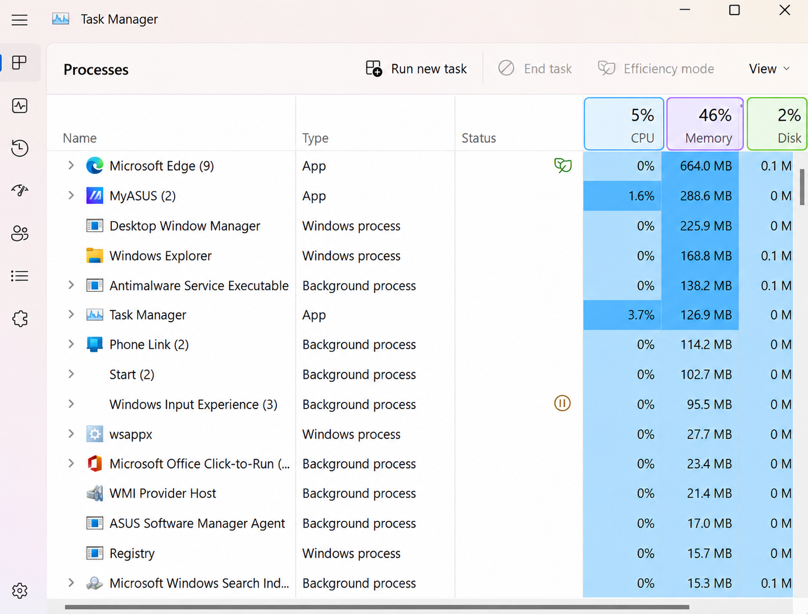
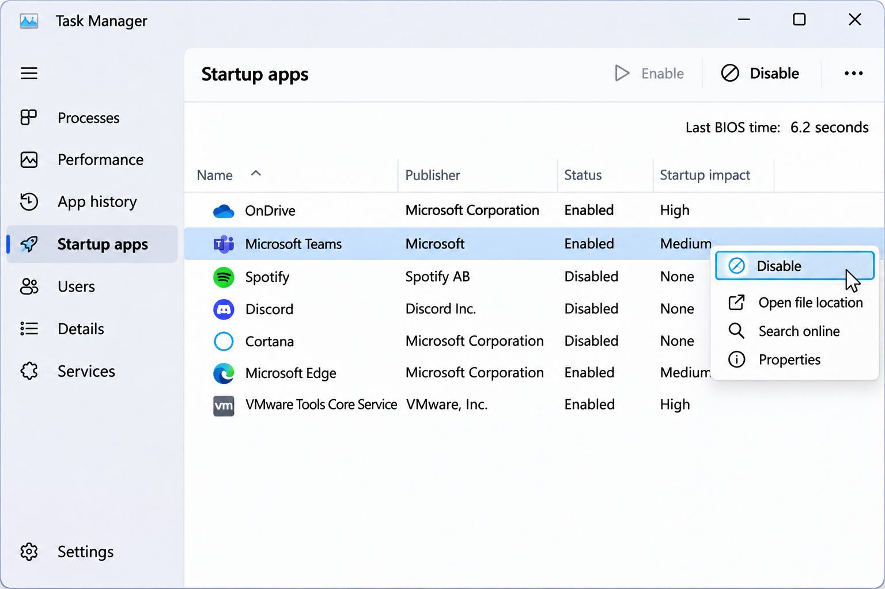
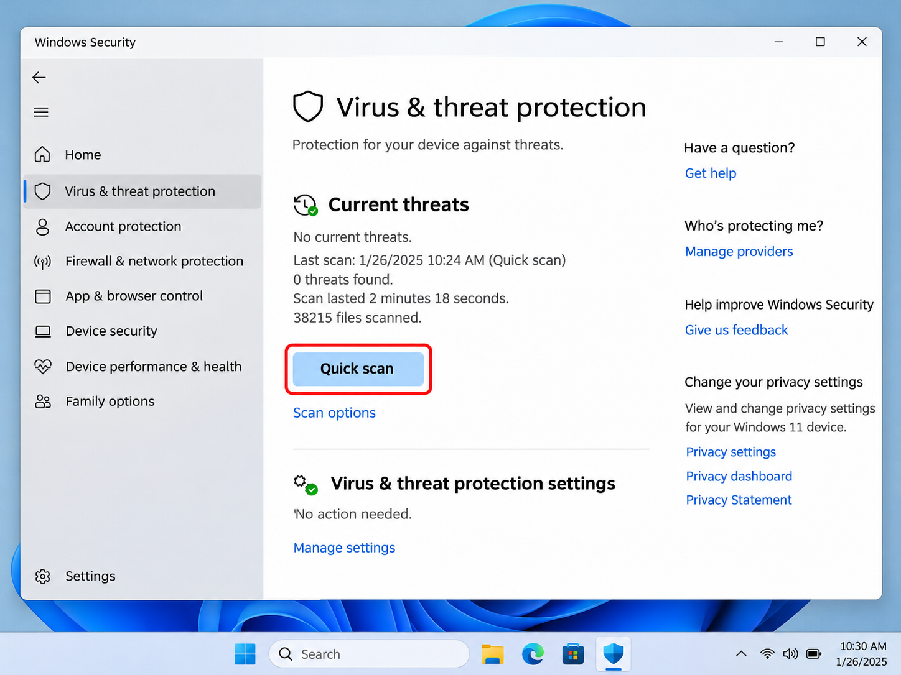

+++
title = "Компютърът работи бавно? Ето как да го ускорите"
slug = "baven-kompyutar"
date = "2026-11-04T22:00:00.000+02:00"
author = "4s"
draft = false
description = "Компютърът работи бавно или забива? Вижте как да ускорите Windows 10 и 11 чрез проверка на програмите, RAM паметта, диска и системните настройки."
tags = ["Windows 11", "Windows 10", "Бавен компютър", "Ускоряване на Windows", "Оптимизация", "Task Manager", "Производителност"]
coverImg = "main-photo.png"
+++
Компютърът зарежда бавно, програмите се отварят със закъснение, а понякога дори браузърът започва да забива?

Причините могат да бъдат различни — твърде много работещи програми, недостатъчно свободна памет, запълнен диск или остарял хардуер.

Преди да мислите за преинсталиране на Windows или покупка на нов компютър, опитайте следните седем неща.

### 1. Проверете какво натоварва компютъра

Първо трябва да разберем какво го забавя.

Натиснете **Ctrl + Shift + Esc**, за да отворите **Task Manager (Диспечер на задачите)**.

В раздела **Processes** ще видите кои програми използват най-много ресурси.

Обърнете внимание на три показателя:

* **CPU** – натоварване на процесора.
* **Memory** – използване на оперативната памет (RAM).
* **Disk** – натоварване на диска.

Натиснете върху съответната колона, за да подредите програмите по използвани ресурси.

Ако някоя позната програма натоварва силно компютъра и не ви е необходима в момента, затворете я по нормалния начин.

Не прекратявайте непознати системни процеси само защото използват много ресурси.

### 2. Спрете ненужните програми при стартиране

Много приложения се стартират автоматично заедно с Windows, дори когато нямате нужда от тях.

Отворете **Task Manager** и изберете раздела **Startup apps**. В Windows 10 той се нарича **Startup**.

Ще видите списък с програмите, които могат да се стартират при включване на компютъра.

Изберете ненужно приложение и натиснете **Disable**.

Например, ако рядко използвате дадена програма за чат или игрови лаунчер, няма причина тя да се зарежда при всяко включване.

Това няма да изтрие програмата. Просто ще трябва да я стартирате ръчно, когато ви потрябва.

Не изключвайте непознати приложения, свързани със защитата или управлението на хардуера.

### 3. Освободете място на системния диск

Когато диск C: е почти запълнен, Windows може да започне да работи по-бавно, особено ако няма достатъчно място за временни файлове и актуализации.

В Windows 11 отворете:

**Settings → System → Storage**

В Windows 10 пътят е **Settings → System → Storage**.

Изберете **Temporary files** и прегледайте файловете, които Windows предлага да премахне.

**Внимание:** Проверете внимателно категориите Downloads и Previous Windows installation(s), преди да ги изтриете.

Ако искате по-подробни инструкции, вижте и нашето [ръководство за освобождаване на място на диск C: в Windows 11](https://cursor.bg/posts/pochistvane-disk-c-windows-11/).

### 4. Премахнете програмите, които не използвате

С времето на компютъра се натрупват програми, игри и помощни приложения, които отдавна сме забравили.

В Windows 11 отворете:

**Settings → Apps → Installed apps**

В Windows 10:

**Settings → Apps → Apps & features**

Прегледайте списъка и премахнете софтуера, който вече не ви е необходим.

Това ще освободи място на диска, а ако някои от програмите работят постоянно във фонов режим, може да намали и натоварването.

Не деинсталирайте непознати драйвери или системни компоненти.

### 5. Проверете компютъра за вируси

Понякога причината за необичайно бавна работа е нежелан или зловреден софтуер.

Windows разполага с вградена защита, така че не е необходимо веднага да инсталирате друга антивирусна програма.

Отворете **Start** и потърсете **Windows Security**.

След това изберете:

**Virus & threat protection → Quick scan**

Изчакайте проверката да приключи.

Ако бъдат открити заплахи, следвайте указанията на Windows Security.

Ако компютърът продължава да се държи подозрително, можете да стартирате и **Full scan** от **Scan options**.

### 6. Проверете за актуализации на Windows

Актуализациите понякога отстраняват грешки, проблеми със съвместимостта и драйверите.

В Windows 11 отворете:

**Settings → Windows Update → Check for updates**

В Windows 10:

**Settings → Update & Security → Windows Update**

Инсталирайте наличните подходящи актуализации и рестартирайте компютъра, ако Windows го изисква.

Не очаквайте всяка актуализация да направи компютъра по-бърз, но поддържането на системата в актуално състояние е важно за стабилността и сигурността.

### 7. Проверете режима на захранване

Ако използвате лаптоп, неговият режим на захранване може да ограничава производителността, за да пести батерия.

В Windows 11 отворете:

**Settings → System → Power & battery**

Намерете **Power mode** и проверете избраната настройка.

Ако е налична, можете да опитате **Best performance**, когато лаптопът е включен към зарядното устройство.

При Windows 10 настройките за захранване може да изглеждат различно в зависимост от устройството.

Имайте предвид, че режимът за по-висока производителност може да увеличи консумацията на енергия и загряването. Ако проблемът е в недостатъчно RAM или бавен диск, тази настройка няма да го реши.

### А ако компютърът продължава да работи бавно?

Рестартирайте го, ако все още не сте го направили, и проверете дали има подобрение.

Ако компютърът е по-стар, причината може да е в самия хардуер.

Например преминаването от механичен твърд диск (HDD) към SSD често води до осезаемо по-бързо стартиране на Windows и зареждане на програмите.

Ако пък оперативната памет постоянно е почти запълнена, добавянето на RAM може да помогне при работа с повече програми едновременно.

Не се доверявайте на програми, които обещават да ускорят компютъра с един бутон. Особено внимателни бъдете с така наречените Registry cleaners.

Най-добрият подход е първо да установите какво точно забавя системата, вместо да променяте настройки на случаен принцип.
