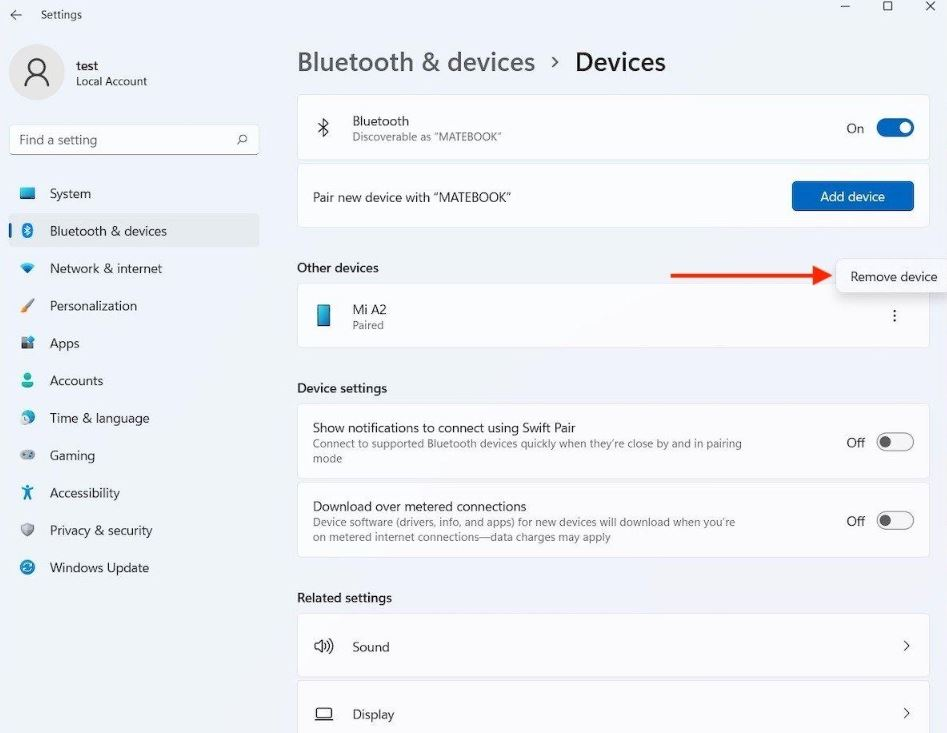
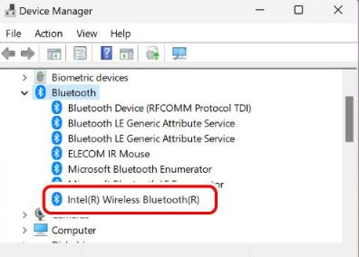

+++
title = "Bluetooth не се свързва в Windows? Ето какво да проверите"
slug = "bluetooth-ne-se-svarzva-windows"
date = "2026-11-02T16:16:00.000+02:00"
author = "4s"
draft = true
description = "Bluetooth не се свързва или Windows не открива устройството? Проверете сдвояването, настройките и драйверите в Windows 10 и 11."
tags = ["Bluetooth", "Windows 11", "Windows 10", "Bluetooth устройства", "Bluetooth драйвер", "Безжични устройства"]
coverImg = "main-photo.png"
+++
Опитвате се да свържете безжични слушалки, мишка или клавиатура към компютъра, но Windows не открива устройството? Или пък то се появява в списъка, но отказва да се свърже?

Причината невинаги е повреда. Понякога Bluetooth е изключен, устройството не е в режим на сдвояване или Windows използва неподходящ драйвер.

Ето откъде да започнете.

### 1. Проверете дали Bluetooth е включен

Първо се уверете, че Bluetooth работи на компютъра.

В Windows 11 натиснете **Win + I** и отворете:

**Settings → Bluetooth & devices**

Проверете дали Bluetooth е включен. Ако вече е активен, изключете го за около 10 секунди и го включете отново.

При Windows 10 настройката се намира в:

**Settings → Devices → Bluetooth & other devices**

Проверете също дали не е включен самолетният режим (**Airplane mode**).

### 2. Проверете дали устройството е готово за свързване

Много Bluetooth устройства трябва да бъдат поставени в специален режим за сдвояване (*Pairing mode*), преди компютърът да ги открие.

При слушалките това често става чрез задържане на определен бутон за няколко секунди. При мишки и клавиатури може да има отделен бутон за Bluetooth.

Точният начин зависи от модела, затова проверете инструкциите на производителя.

Поставете устройството близо до компютъра и се уверете, че батерията му не е изтощена.

Ако слушалките вече са свързани към телефона ви, временно изключете Bluetooth на телефона и опитайте отново.

### 3. Премахнете устройството и го добавете отново

Ако Windows показва устройството, но не успява да се свърже с него, опитайте да го сдвоите наново.

В Windows 11 отворете:

**Settings → Bluetooth & devices → Devices**

Намерете устройството, натиснете трите точки до него и изберете **Remove device**.

След това натиснете **Add device → Bluetooth**.

Поставете устройството в режим на сдвояване и го изберете от списъка.

При Windows 10 използвайте:

**Settings → Devices → Bluetooth & other devices → Remove device**

След това изберете **Add Bluetooth or other device**, за да го добавите отново.

### 4. Windows не открива Bluetooth устройството?

Ако използвате Windows 11 и устройството изобщо не се появява при търсене, проверете настройката за откриване.

Отворете:

**Settings → Bluetooth & devices → Devices**

Потърсете **Bluetooth devices discovery** и изберете **Advanced**.

Така Windows може да показва и устройства, които не се появяват при стандартното търсене.

След това опитайте отново да добавите устройството.

### 5. Проверете Bluetooth драйвера

Ако проблемът продължава, е възможно причината да е в драйвера на Bluetooth адаптера.

Натиснете с десния бутон върху **Start** и отворете **Device Manager**.

Разгънете раздела **Bluetooth**.

Намерете Bluetooth адаптера, натиснете върху него с десния бутон и изберете:

**Update driver → Search automatically for drivers**

Ако Windows открие нов драйвер, следвайте инструкциите и рестартирайте компютъра.

Ако не открие нищо, можете да проверите за подходящ драйвер на официалния сайт на производителя на лаптопа или дънната платка.

Не използвайте случайни програми, които обещават автоматично да поправят всички драйвери.

### 6. Използвайте диагностиката на Windows

Ако нищо дотук не е помогнало, опитайте вградения инструмент за диагностика.

В Windows 11 отворете **Start**, потърсете **Get Help** и въведете **Bluetooth troubleshooter**.

Следвайте инструкциите на екрана.

При Windows 10 инструментът може да бъде достъпен през **Settings → Update & Security → Troubleshoot → Additional troubleshooters → Bluetooth**, в зависимост от версията.

Накрая рестартирайте компютъра и опитайте отново да свържете устройството.

### А ако Bluetooth изобщо липсва от Windows?

Ако не виждате настройка за Bluetooth и в **Device Manager** няма Bluetooth адаптер, проверете дали компютърът действително разполага с такъв.

Не всички настолни компютри имат вграден Bluetooth. При някои модели е необходим отделен USB Bluetooth адаптер.

Ако преди сте използвали Bluetooth без проблем, но настройката внезапно е изчезнала, е възможно да има проблем с драйвера или самия адаптер.

Проверете за актуализации на Windows и за драйвери от производителя.

Не е необходимо веднага да преинсталирате Windows. Най-често има смисъл първо да проверите настройките, сдвояването и драйвера на устройството.
