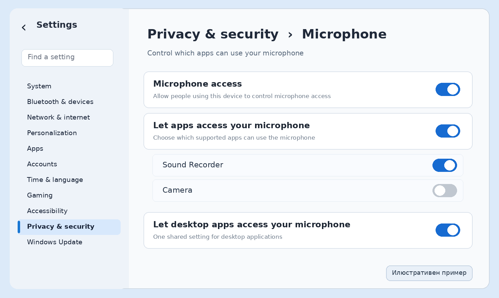
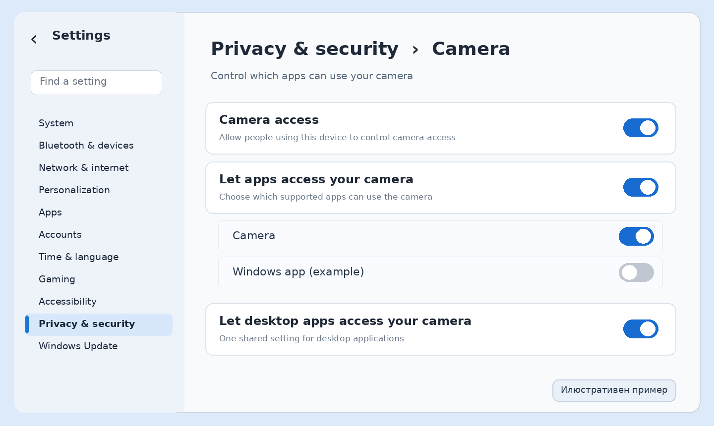

+++
title = "Кои приложения имат достъп до камерата и микрофона в Windows?"
slug = "dostap-kamera-mikrofon-windows"
date = "2026-11-21T16:35:00.000+02:00"
author = "4s"
draft = true
description = "Проверете кои приложения имат достъп до камерата и микрофона в Windows 10 и 11. Научете как да управлявате разрешенията и да защитите поверителността си."
tags = ["Windows 11", "Windows 10", "Поверителност", "Камера", "Микрофон", "Разрешения за приложения", "Сигурност"]
coverImg = "windows-privacy-and-security.png"
+++
Камерата и микрофонът са сред устройствата, до които приложенията могат да поискат достъп. Разрешенията често се дават при първото използване на програма, а след време лесно забравяме кои сме одобрили.

Windows 10 и 11 разполагат с вградени настройки, чрез които можем да **проверяваме и ограничаваме достъпа до камерата и микрофона**, без допълнителен софтуер.

### 1. Кои приложения имат достъп до микрофона?

В Windows 11 отворете **Settings → Privacy & security → Microphone**.

Тук ще откриете настройката **Microphone access**, която управлява достъпа на приложенията до микрофона.

Под нея се намира **Let apps access your microphone** и списък с приложения, за които можете да разрешавате или забранявате достъпа поотделно.

Ако определено приложение не се нуждае от микрофон, изключете разрешението му.

В Windows 10 настройките се намират в **Settings → Privacy → Microphone**.

### 2. Как да проверим достъпа до камерата?

Отворете **Settings → Privacy & security → Camera** в Windows 11.

Настройката **Camera access** управлява достъпа до камерата, а **Let apps access your camera** позволява да променяте разрешенията на отделните приложения от поддържания списък.

Например можете да забраните достъпа на приложение, което не използвате за снимки или видеоразговори.

В Windows 10 отворете **Settings → Privacy → Camera**.

**Важно:** Ако изключите достъпа до камерата или микрофона, някои приложения за видеоразговори може да спрат да работят правилно, докато не възстановите разрешението.

### 3. Защо Zoom, Discord или браузърът не се виждат в списъка?

Windows прави разграничение между приложения от Microsoft Store и традиционни настолни програми.

При много приложения от Microsoft Store можете да управлявате разрешенията поотделно.

За настолните програми се използват общите настройки **Let desktop apps access your microphone** и **Let desktop apps access your camera**.

Те не позволяват да забраните достъпа само на една конкретна настолна програма.

Освен това някои настолни приложения може изобщо да не се появяват в показаните списъци.

При браузърите е добре да проверите и разрешенията за камера и микрофон на отделните сайтове.

### 4. Означава ли разрешеният достъп, че някой записва?

Не. Разрешението показва, че дадено приложение може да използва устройството, но не доказва, че в момента записва звук или видео.

Windows може да показва индикатор, когато микрофонът или камерата се използват.

В настройките за поверителност може да видите и информация за определени приложения, които наскоро са използвали устройството. Тази информация обаче не е пълен журнал на всички действия.

### 5. Как да подобрим поверителността си?

Проверявайте периодично разрешенията на приложенията, особено след инсталиране на нов софтуер.

Оставяйте достъп само когато е необходим и преглеждайте разрешенията на уебсайтовете в браузъра.

Ако камерата има физически капак, можете да го използвате, когато не провеждате видеоразговори.

### Заключение

Настройките **Camera** и **Microphone** в Windows дават бърз начин да проверите и ограничите достъпа на приложенията до тези устройства.

Те не заменят антивирусната защита, но са полезна стъпка към по-добър контрол върху личната информация.
