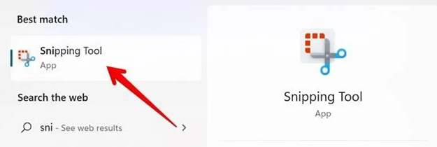

+++
title = "Как да направим екранна снимка в Windows 11"
slug = "ekranna-snimka-windows-11"
date = "2026-10-30T13:09:00.000+02:00"
author = "4s"
draft = true
description = "Как се прави екранна снимка в Windows 11? Научете как да използвате Print Screen, Win + Shift + S и Snipping Tool и къде се запазват снимките."
tags = ["Windows 11", "Екранна снимка", "Screenshot", "Print Screen", "Snipping Tool", "Клавишни комбинации"]
coverImg = "main-photo1212.png"
+++
Искате да снимате нещо от екрана на компютъра, за да го изпратите на приятел или да запазите важна информация?

В Windows 11 това става за секунди, без да инсталирате допълнителни програми. Можете да снимате целия екран, само един прозорец или определена част от него.

Ето най-лесните начини.

### 1. Снимка на избрана част от екрана – Win + Shift + S

Това вероятно е най-удобната комбинация, особено когато искате да снимате само определена област.

Натиснете едновременно:

**Win + Shift + S**

Екранът леко ще потъмнее, а в горната част ще се появи малко меню.

С мишката маркирайте областта, която искате да заснемете.

Снимката ще бъде копирана в клипборда и можете веднага да я поставите в чат, документ или Paint с **Ctrl + V**.

В актуалните версии на Windows 11 Snipping Tool може също автоматично да запазва снимките в папката Screenshots.

### 2. Снимка на целия екран – Win + PrtSc

Ако искате да заснемете всичко, което се вижда на монитора, използвайте:

**Win + PrtSc (Print Screen)**

Windows ще направи екранна снимка и ще я запази като файл.

Можете да я намерите в:

**Pictures → Screenshots (Картини → Екранни снимки)**

При някои лаптопи е необходимо да използвате и клавиша **Fn**, например **Fn + Win + PrtSc**.

### 3. Снимка само на активния прозорец – Alt + PrtSc

Понякога не искате да снимате целия работен плот, а само програмата, която използвате.

Първо изберете прозореца, който искате да заснемете, след което натиснете:

**Alt + PrtSc**

Windows ще копира изображението на активния прозорец в клипборда.

Отворете Paint или друга програма и натиснете **Ctrl + V**, за да поставите снимката.

След това можете да я запазите като PNG или JPG.

### 4. Използвайте Snipping Tool

Windows 11 има вграден инструмент за екранни снимки, наречен **Snipping Tool**.

Отворете **Start**, напишете `Snipping Tool` и стартирайте приложението.

Оттук можете да изберете какво да снимате:

* Правоъгълна област от екрана.
* Определен прозорец.
* Целия екран.
* Област със свободно очертана форма.

Инструментът позволява също да изрязвате снимката, да рисувате върху нея и да подчертавате важни части.

Има и функция за забавено заснемане (**Delay**), която е удобна, ако искате да снимате отворено меню или прозорец, появяващ се при определено действие.

### Къде се запазват екранните снимки?

Това зависи от начина, по който сте ги направили.

При **Win + PrtSc** снимката обикновено се запазва автоматично в **Pictures → Screenshots**.

При **Alt + PrtSc** изображението се копира в клипборда и трябва да го поставите в програма, за да го запазите.

При **Win + Shift + S** снимката също се копира в клипборда, а Snipping Tool може автоматично да запази и файл според настройките си.

Ако използвате OneDrive за архивиране на папката Pictures, снимките може да се намират и там.

### Кой начин е най-удобен?

За ежедневна употреба бихме избрали **Win + Shift + S**. Комбинацията позволява да снимате точно това, което ви трябва, без после да изрязвате ненужните части.

Ако обаче искате бързо да запазите целия екран като файл, **Win + PrtSc** е по-подходящият избор.

И двата начина работят без допълнителни програми.
