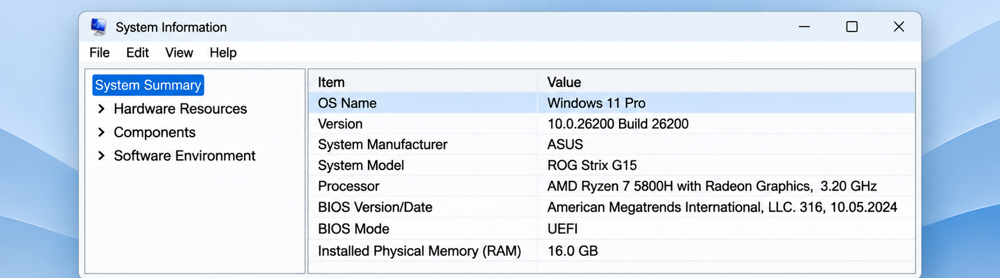
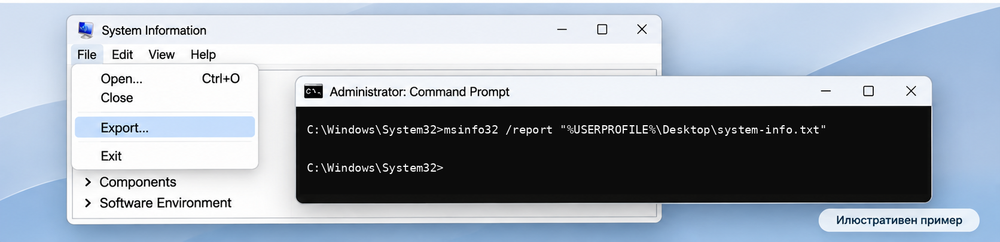

+++
title = "Как да видим пълната информация за компютъра с една команда?"
slug = "informacia-kompyutar-msinfo32"
date = "2026-11-14T20:15:00.000+02:00"
author = "4s"
draft = false
description = "Вижте модела на компютъра, процесора, RAM паметта и BIOS версията с командата msinfo32 в Windows 10 и 11. Научете как да запазите системен отчет."
tags = ["Windows 11", "Windows 10", "msinfo32", "System Information", "Хардуер", "BIOS", "Системна информация", "Диагностика"]
coverImg = "windows-11-system-information-desktop-mockup.png"
+++
Искате да разберете точния модел на компютъра, какъв процесор използва или коя версия на BIOS е инсталирана?

Не е необходимо да разглобявате устройството или да инсталирате допълнителен софтуер.

Windows 10 и 11 имат вграден инструмент **System Information**, който показва подробна информация за хардуера и операционната система.

### 1. Как да отворим System Information?

Натиснете **Win + R**, за да отворите прозореца Run.

Въведете командата:

`msinfo32`

Натиснете **Enter**.

Ще се отвори прозорецът **System Information**. В лявата част ще видите категориите, а вдясно – информацията за избраната категория.

По подразбиране се отваря **System Summary**, където са събрани най-важните характеристики на компютъра.

### 2. Каква информация можем да открием?

В раздела **System Summary** потърсете следните показатели:

| Показател                       | Какво означава                       |
| ------------------------------- | ------------------------------------ |
| OS Name                         | Инсталираната версия на Windows      |
| System Manufacturer             | Производител на компютъра            |
| System Model                    | Модел на устройството                |
| Processor                       | Модел на процесора                   |
| BIOS Version/Date               | Версия и дата на BIOS                |
| BIOS Mode                       | Режим на зареждане – UEFI или Legacy |
| Installed Physical Memory (RAM) | Инсталирана оперативна памет         |

Тази информация е особено полезна, когато търсите подходящи драйвери или искате да проверите дали даден компонент е съвместим с компютъра.

В лявото меню можете да разгледате и **Components**, където има информация за видеокартата, мрежовите адаптери, устройствата за съхранение и други компоненти.

Имайте предвид, че част от информацията зависи от това какво предоставят производителят и драйверите на устройството.

### 3. Как да запазим информацията във файл?

Ако трябва да изпратите системните характеристики на техник или техническа поддръжка, можете да създадете текстов отчет.

Отворете **Command Prompt** и въведете:

`msinfo32 /report "%USERPROFILE%\Desktop\system-info.txt"`

Командата ще събере системната информация и ще я запише във файл с име **system-info.txt** на работния плот, ако Desktop се намира на стандартното си място.

Създаването на отчета може да отнеме известно време.

Можете също да използвате **File → Export** директно от прозореца System Information.

**Важно:** Преди да изпратите отчета на друг човек, прегледайте съдържанието му. Той може да включва потребителски имена, името на компютъра и други системни данни.

### Заключение

С командата `msinfo32` получавате бърз достъп до подробна информация за компютъра, без допълнителни програми.

Инструментът е полезен при диагностика, проверка на BIOS версията, търсене на драйвери и установяване на хардуерните характеристики.

А ако трябва да запазите информацията, можете да я експортирате във файл само с една допълнителна команда.
