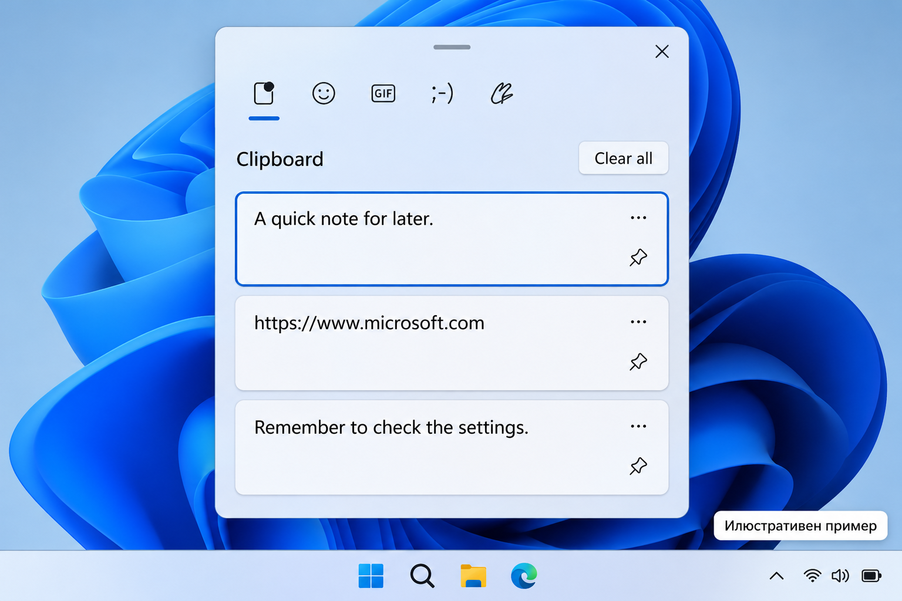
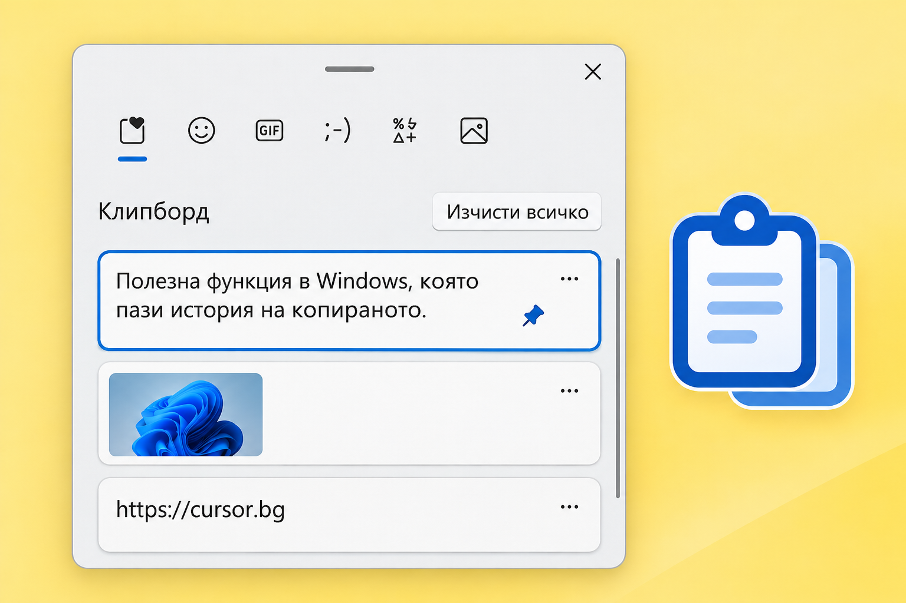

+++
title = "История на копирания текст в Windows – как работи Win + V"
slug = "istoria-klipbord-windows"
date = "2026-11-18T19:10:00.000+02:00"
author = "4s"
draft = true
description = "Вижте как с Win + V да отворите историята на клипборда в Windows 10 и 11, да използвате предишно копиран текст, да закрепвате записи и да ги изтривате."
tags = ["Windows 11", "Windows 10", "Clipboard History", "Клипборд", "Win + V", "Клавишни комбинации", "Полезни функции"]
coverImg = "windows-11-clipboard-history-with-win-v.png"
+++
Копирали сте важен текст, но след това сте натиснали Ctrl + C върху нещо друго? Обикновеното поставяне с Ctrl + V използва последния копиран елемент, но Windows може да пази и история на предишните.

Функцията се нарича **Clipboard History** и е налична в Windows 10 и 11. Чрез нея можете да връщате по-рано копирани текстове, без да инсталирате допълнителна програма.

### 1. Как да включим историята на клипборда?

Натиснете **Win + V**.

Ако функцията все още не е активирана, Windows ще ви предложи да я включите чрез **Turn on**.

След активирането всичко, което копирате с **Ctrl + C**, може да се появява в историята на клипборда, стига форматът и размерът му да се поддържат.

Можете да намерите настройката и в **Settings → System → Clipboard → Clipboard history**.

Историята започва да се събира след включването на функцията. Тя не възстановява текстове, копирани преди това.

### 2. Как да използваме предишно копиран текст?

Копирайте няколко различни текста, след което натиснете **Win + V**.

Ще се отвори малък прозорец с наличните записи.

Поставете курсора там, където искате да вмъкнете текста, отворете историята и изберете желания запис.

Windows ще го постави в активното текстово поле, ако приложението поддържа тази операция.

Така можете да използвате по-стари записи, без да копирате всичко отново.

### 3. Как да запазим често използван текст?

В историята на клипборда можете да закрепвате определени записи, за да не изчезват при обичайното ѝ изчистване.

Отворете **Win + V**, намерете желания текст и използвайте иконата за закрепване или менюто с трите точки **(...)**, в зависимост от версията на Windows.

Например можете да запазите често използван отговор, адрес или кратък текст.

Закрепените записи се запазват и след рестартиране на компютъра, докато не ги премахнете.

### 4. Как да изчистим историята?

Отворете **Win + V** и изберете **Clear all**, за да изтриете незакрепените записи.

За премахване на конкретен елемент отворете менюто **(...)** до него и изберете **Delete**, ако е налично.

Можете да изчистите историята и през **Settings → System → Clipboard → Clear clipboard data**.

Имайте предвид, че закрепените записи не се премахват при обикновеното изчистване. Ако искате да изтриете и тях, премахнете ги поотделно.

### Какво е добре да знаете?

Clipboard History съхранява до **25 записа**, като всеки поддържан елемент може да бъде с размер до **4 MB**.

Историята не е архив на всичко, което някога сте копирали. По-старите незакрепени записи се премахват, когато се достигне ограничението.

При рестартиране на Windows историята се изчиства, с изключение на закрепените елементи.

**Важно:** Не закрепвайте пароли, кодове за достъп или друга чувствителна информация. Ако използвате споделен компютър, изчиствайте историята след работа.

### Заключение

Клавишната комбинация **Win + V** е удобен начин да се върнете към предишно копиран текст в Windows.

С нея можете да използвате няколко записа последователно, да запазвате често използвани текстове и да управлявате историята на клипборда от едно място.
