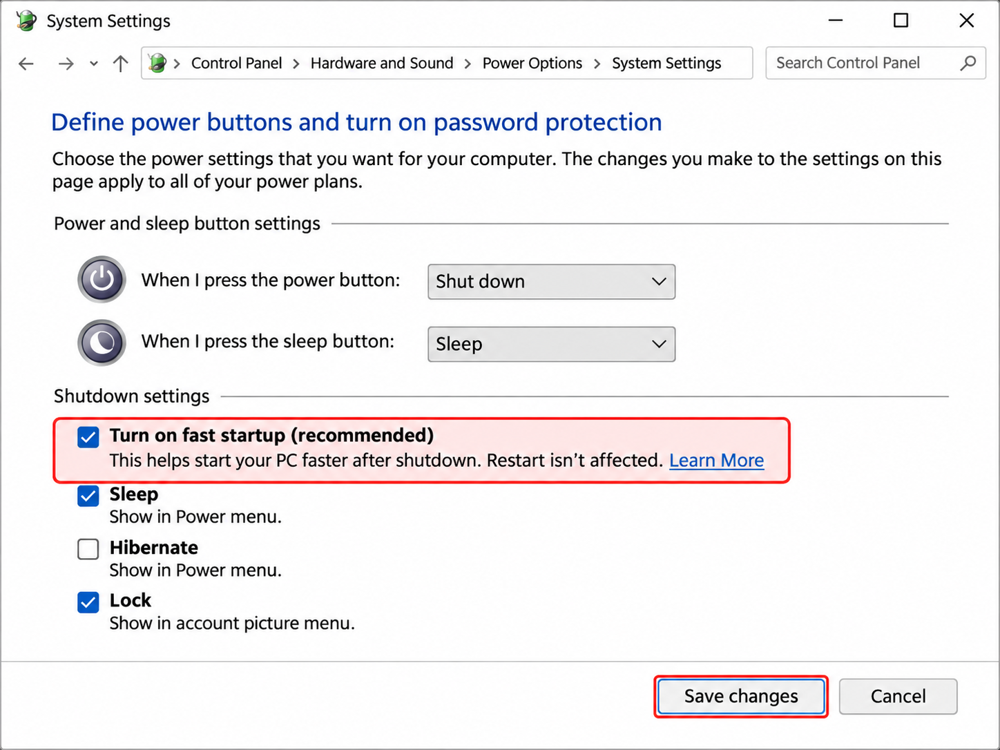
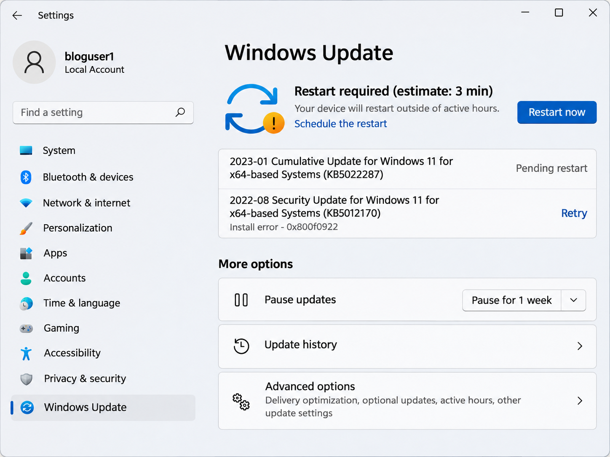
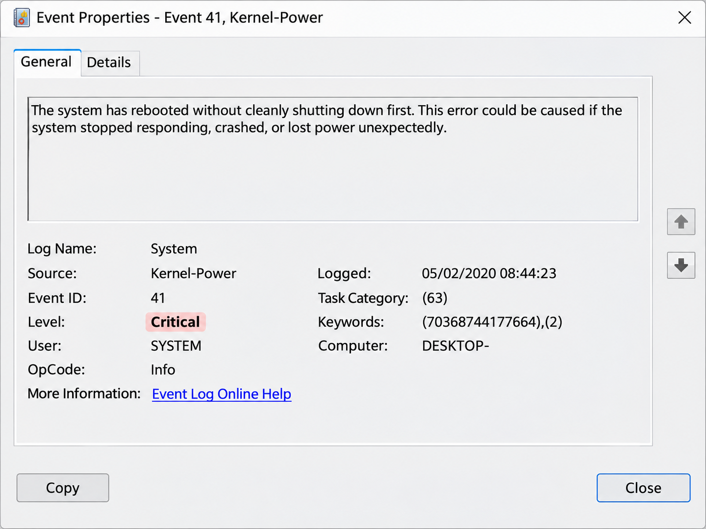

+++
title = "Компютърът не се изключва напълно – какво да проверим?"
slug = "kompyutar-ne-se-izklyuchva"
date = "2026-11-07T20:31:00.000+02:00"
author = "4s"
draft = false
description = "Компютърът не се изключва, вентилаторите продължават да работят или Windows се рестартира сам? Вижте как да откриете причината в Windows 10 и 11."
tags = ["Windows 11", "Windows 10", "Изключване на компютър", "Fast Startup", "Захранване", "Event Viewer", "Драйвери"]
coverImg = "main-photo.png"
+++
Натискате **Shut down**, екранът изгасва, но вентилаторите продължават да работят? Или компютърът се изключва и след няколко секунди отново се включва?

Причината невинаги е повреда. Понякога Windows не успява да приключи работата си, драйвер блокира изключването или настройка на захранването предизвиква неочаквано поведение.

Ето как да откриете откъде идва проблемът.

### 1. Уверете се, че компютърът действително се изключва

Първо разграничете трите основни действия на Windows:

* **Shut down** – изключва компютъра.
* **Restart** – рестартира Windows и зарежда системата отново.
* **Sleep** – преминава в режим с ниска консумация, от който компютърът може бързо да се събуди.

Отворете **Start → Power → Shut down**.

Ако използвате бутона за захранване на кутията или лаптопа, проверете какво действие е зададено за него.

Отворете **Control Panel → Hardware and Sound → Power Options → Choose what the power buttons do**.

При **When I press the power button** проверете дали е избрано **Shut down**, а не Sleep.

Ако използвате лаптоп, обърнете внимание и на настройката **When I close the lid**.

### 2. Проверете функцията Fast Startup

**Fast Startup** позволява на Windows да стартира по-бързо, като запазва част от състоянието на системата при изключване.

В някои случаи това може да доведе до затруднения при изключване, особено при несъвместим драйвер.

За проверка:

1. Отворете **Control Panel → Hardware and Sound → Power Options**.
2. Изберете **Choose what the power buttons do**.
3. Натиснете **Change settings that are currently unavailable**.
4. Премахнете отметката от **Turn on fast startup (recommended)**.
5. Изберете **Save changes**.

   

След това изключете компютъра по нормалния начин и проверете дали поведението се е променило.

Ако опцията липсва, възможно е хибернацията да не е активна или устройството да не поддържа тази функция.

Изключването на Fast Startup може да увеличи времето за стартиране, но не пречи на нормалната работа на компютъра. Ако не установите разлика, можете да върнете предишната настройка.

### 3. Опитайте пълно изключване на Windows

Ако проблемът продължава, можете да проверите дали компютърът се изключва правилно, когато се заобиколи Fast Startup.

Първо запазете отворените файлове и затворете програмите.

Натиснете **Win + R**, въведете:

shutdown /s /t 0

Натиснете **Enter**.

Командата заявява незабавно стандартно пълно изключване, без режима Fast Startup.

Ако компютърът се изключва нормално по този начин, но не и през обичайното меню Shut down, това е основание да проверите Fast Startup и свързаните с него драйвери.

Ако продължава да работи и след тази команда, причината вероятно е другаде.

**Важно:** Не използвайте параметъра `/f` за принудително затваряне на програмите, ако имате незапазена работа.

### 4. Проверете за незавършени актуализации

Понякога Windows трябва да завърши инсталирането на актуализации, преди да може да се рестартира или изключи нормално.

В Windows 11 отворете:

**Settings → Windows Update**

В Windows 10:

**Settings → Update & Security → Windows Update**

Проверете дали има актуализации, които изчакват рестартиране.

Ако има, запазете работата си и изберете **Restart now** или съответната предложена опция.

След като актуализациите приключат, опитайте отново да изключите компютъра.

Ако Windows показва съобщение, че дадена програма предотвратява изключването, запазете документите си и затворете посоченото приложение.

Не прекъсвайте захранването, докато Windows инсталира актуализации.

### 5. Изключете временно външните устройства

USB устройства и техните драйвери понякога могат да повлияят на поведението при изключване или събуждане на компютъра.

Изключете временно ненужните периферни устройства, например:

* USB флашки и външни дискове.
* Принтери и скенери.
* USB хъбове.
* Гейм контролери и други аксесоари.

Не изключвайте вътрешни компоненти и не разглобявайте компютъра.

След това опитайте стандартно изключване.

Ако проблемът изчезне, включвайте устройствата отново едно по едно, за да установите кое е свързано с поведението.

Това не доказва непременно хардуерна повреда — възможно е причината да е драйвер или настройка за управление на захранването.

### 6. Проверете драйверите

Ако компютърът е започнал да се изключва неправилно след инсталиране на драйвер или актуализация, проверете съответното устройство.

Натиснете **Win + X → Device Manager**.

Потърсете устройства с жълт предупредителен символ.

Ако има такива, отворете **Properties**, за да видите съобщението за грешка.

Обърнете специално внимание на драйверите за:

* Чипсета и управлението на захранването.
* Видеокартата.
* Мрежовите и безжичните адаптери.
* USB контролерите.

Проверете за актуализации чрез **Windows Update** или официалния сайт на производителя на компютъра или дънната платка.

Ако проблемът е започнал непосредствено след конкретна актуализация на драйвер, в **Properties → Driver** може да е налична опцията **Roll Back Driver**.

Не инсталирайте произволни пакети с драйвери от непознати сайтове.

### 7. Проверете какво показва Event Viewer

Ако компютърът продължава да се изключва неправилно или се рестартира сам, системните записи могат да ни дадат допълнителна информация.

Натиснете **Win + R**, въведете:

eventvwr.msc

Отворете:

**Windows Logs → System**

Потърсете записи около часа, в който сте опитали да изключите компютъра.

Полезни са следните събития:

Например **Event ID 41** може да се появи при прекъсване на захранването, системен срив или принудително изключване.

Сам по себе си този запис не доказва повреда в захранването.

Разгледайте описанието на събитието и други записи от същия период, вместо да правите заключение само по номера на грешката.

### А ако компютърът се изключва и веднага се включва отново?

Това е малко по-различен случай.

Ако Windows се изключва нормално, но компютърът сам стартира отново, причината може да е свързана с настройки за събуждане, мрежов адаптер, BIOS/UEFI или неочакван системен срив.

Проверете дали проблемът се появява и след пълно изключване чрез:

shutdown /s /t 0

Ако се повтаря, разгледайте Event Viewer и проверете дали производителят на устройството има указания за настройките **Wake on LAN** и **Power on by USB**.

Не изключвайте тези функции на случаен принцип, особено ако компютърът се управлява дистанционно.

### Кога да потърсим хардуерна причина?

Ако екранът изгасва, но вентилаторите продължават да работят неопределено дълго, дори след пълно изключване, причината може да е в BIOS/UEFI, драйверите или хардуера.

Ако проблемът е започнал след смяна на компоненти, проверете съвместимостта и настройките според документацията на производителя.

При необичайна миризма, искрене или силно загряване прекратете използването на устройството и потърсете техническа помощ.

### Заключение

Когато компютърът не се изключва напълно, започнете с най-лесните проверки: дали използвате Shut down, дали Fast Startup влияе на поведението и дали Windows има незавършени актуализации.

Ако това не помогне, проверете външните устройства, драйверите и записите в Event Viewer.

Най-важното е да установите дали Windows не успява да приключи изключването, или компютърът се включва отново след него. Двата случая могат да имат различни причини.

Event IDКакво означава1074Показва кой процес или потребител е поискал изключване или рестартиране6006Услугата Event Log е спряла нормално6008Предишното изключване е било неочаквано41 (Kernel-Power)Windows установява, че предишното изключване не е било нормално
