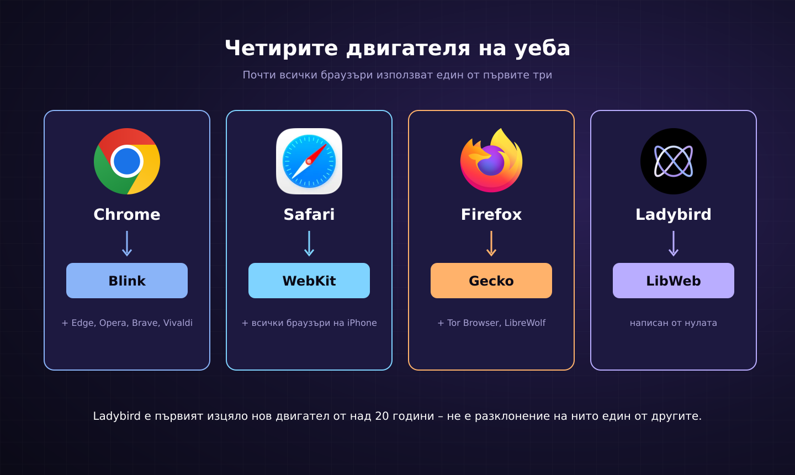
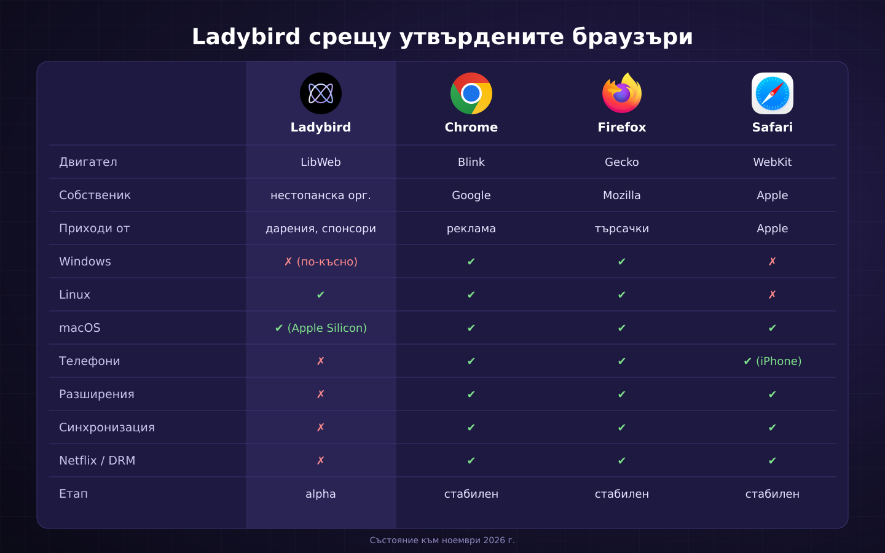

+++
title = "Ladybird: първият наистина нов браузър от 20 години насам"
slug = "ladybird-brauzar"
date = "2026-11-22T13:12:00.000+02:00"
author = "mos"
draft = false
description = "Ladybird е браузър с изцяло собствен двигател, без код от Chrome, Firefox или Safari. Какво може, какво му липсва, плюсове, минуси и сравнение с утвърдените браузъри."
tags = ["Ladybird", "Браузър", "Chrome", "Firefox", "Safari", "Отворен код", "Поверителност"]
coverImg = "main.png"
+++
Chrome, Edge, Opera, Brave, Vivaldi – изглеждат различно, но под капака всички използват един и същ двигател от Google. Реално днес на пазара има само **три** браузърни двигателя и зад всеки стои голяма компания.

**Ladybird** иска да промени това. На 23 ноември 2026 г. браузърът излезе в първата си публична **alpha** версия. Ето какво може, какво все още не може и струва ли си да го пробвате.

### Какво е Ladybird?

Ladybird е браузър с **отворен код**, чийто двигател е написан **изцяло от нулата**. Той не е разклонение на Chromium, Firefox или WebKit – HTML, CSS, JavaScript, WebAssembly и всичко останало са собствена разработка.

Проектът започва като част от операционната система SerenityOS, създадена от **Андреас Клинг**, бивш инженер по WebKit в Apple. От 2024 г. Ladybird е отделен проект, който се управлява от американска **нестопанска организация** – Ladybird Browser Initiative.

### Защо това е важно?

Днес почти всички браузъри използват един от трите големи двигателя:

- **Blink** (Google) – Chrome, Edge, Opera, Brave, Vivaldi и повечето други.
- **WebKit** (Apple) – Safari и всички браузъри на iPhone.
- **Gecko** (Mozilla) – Firefox и браузърите, базирани на него.

Когато един двигател доминира, неговият собственик на практика решава как изглежда уебът. Сайтовете се тестват само в Chrome, а нови функции се налагат, защото „Chrome вече ги има“. Четвърти независим двигател връща конкуренцията и прави уеб стандартите по-честни.

### Как се финансира?

Това е една от най-интересните страни на проекта. Ladybird **не взима пари от търсачки**, не показва реклами и няма да продава данните ви. Финансира се само от **дарения и спонсори** – сред тях са Cloudflare, Proton и Shopify. Според проекта спонсорите нямат право на глас за техническите решения.

За сравнение: Firefox получава по-голямата част от приходите си от Google, срещу това Google да е търсачката по подразбиране. Ladybird дори няма търсачка по подразбиране – при първото пускане вие избирате дали да е Google, DuckDuckGo, Ecosia или друга.

### Какво може alpha версията?

- **Отваря реални сайтове.** Повечето популярни сайтове, включително Google и YouTube, се зареждат и работят нормално.
- **Добра съвместимост със стандартите.** В тестовете Web Platform Tests Ladybird вече изпреварва Safari Technology Preview и е съвсем близо до Firefox.
- **Основни функции:** раздели (включително вертикални), отметки, история, търсене в разделите, възстановяване на сесията, панел за изтегляния, профили и частен режим.
- **Вграден блокер на реклами** с изключения за отделни сайтове (по подразбиране е изключен).
- **Принудителен тъмен режим** за сайтове, които нямат собствен.
- **Инструменти за разработчици** – поддържа WebDriver и протокола на Firefox DevTools.
- **Модерна архитектура** – всеки раздел работи в отделен процес, а части от кода постепенно се пренаписват на по-сигурния език Rust.

### Какво липсва?

- **Няма версия за Windows.** Alpha версията е само за Linux и за Mac с Apple Silicon. Windows ще бъде добавен по-късно, без конкретна дата.
- **Няма версия за телефони.**
- **Няма разширения** – нито uBlock Origin, нито мениджър на пароли като разширение.
- **Няма внасяне на данни** от други браузъри – отметки и пароли трябва да пренесете ръчно.
- **Стрийминг услугите с DRM защита не работят** – например Netflix и Spotify.
- **По-бавен е** – вижте теста за скорост по-долу.


**Alpha версията не е проверена за сигурност.** Самите разработчици предупреждават, че някои сайтове няма да работят, браузърът ще се срива и засега **не обещават сигурност**.


### Колко е бърз?

Скоростта на браузърите обикновено се мери с теста **Speedometer 3.1**, който симулира работа със съвременни уеб приложения. По-високият резултат е по-добър.

| Браузър | Speedometer 3.1 |
|---|---|
| Chrome | 34.3 |
| Firefox | 29.9 |
| **Ladybird** | **10.5** |
| Safari | около 7 % под Chrome* |

Резултатите за Chrome, Firefox и Ladybird са измерени на един и същ лаптоп с Linux. Ladybird е около **три пъти по-бавен** от Chrome и Firefox.

\*Safari не работи на Linux, затова не може да участва в същия тест. В тестове на Mac той обикновено е съвсем близо до Chrome – например 51.3 срещу 55.3 точки. На Mac с M1 Ladybird постига около 13 точки.

Числата са от тестове на отделни хора, а не официални резултати, и зависят от компютъра. Важното е съотношението: Ladybird все още е значително по-бавен, но бързо наваксва – само през октомври 2026 г. резултатът му в по-стария Speedometer 2 се увеличи почти двойно, от 84 на 156.

### Сравнение с Chrome, Firefox и Safari

### Предимства

- **Истинска независимост** – нито ред код от Google, Apple или Mozilla.
- **Без бизнес модел, базиран на вашите данни** – няма реклами, проследяване или сделки с търсачки.
- **Отворен код** с разрешителен BSD лиценз.
- **Бързо развитие** – за няколко години проектът стигна от нула до съвместимост, сравнима с Firefox и Safari.

### Недостатъци

- **Още не е за ежедневна употреба** – липсват основни функции и има сривове.
- **Няма Windows** – за повечето читатели това означава, че засега не може да се пробва.
- **По-бавен** от утвърдените браузъри.
- **Няма разширения** – а за много хора блокерът на реклами и мениджърът на пароли са задължителни.
- **Дълъг път напред** – beta версията е планирана за 2027 г., а стабилната – за 2028 г.

### Струва ли си да го пробвате?

Ако използвате **Linux или Mac** и сте любопитни – да. Инсталира се лесно (за Linux има Flatpak и пакети за Ubuntu и Fedora), а е интересно да видите как изглежда уебът през съвсем различен двигател. Ако правите сайтове, Ladybird е полезен и за тестване в „четвърти“ браузър.


**Не използвайте Ladybird за банкиране, важни акаунти или работа.** За тях останете на Firefox, Chrome или Safari, поне докато не излезе стабилна версия.


### Защо да следим развитието му?

Дори да не го инсталирате днес, Ladybird си заслужава вниманието:

- **Развива се изключително бързо.** През 2026 г. проектът добави частен режим, профили, JIT компилатор за JavaScript, нов двигател за WebAssembly и почти удвои скоростта си само за месец. Това, което липсва днес, може да е налично след няколко месеца.
- **Пътят е ясен.** Beta версията е планирана за **2027 г.**, а стабилната – за **2028 г.**. Версията за Windows също е в плановете.
- **Засяга всички нас.** Ако Ladybird успее, Google, Apple и Mozilla ще имат истински конкурент. Повече конкуренция означава по-добри стандарти, по-малко зависимост от една компания и повече избор за потребителите – дори за тези, които никога няма да го инсталират.
- **Показва, че е възможно.** Доскоро се смяташе, че нов браузърен двигател е непосилна задача за всеки извън големите компании. Ladybird доказва обратното.

Ladybird няма да замени браузъра ви утре. Но е първият от много години насам проект, който реално може да върне конкуренцията между двигателите. Затова си струва да проверявате как се развива – а ние ще ви държим в течение.
