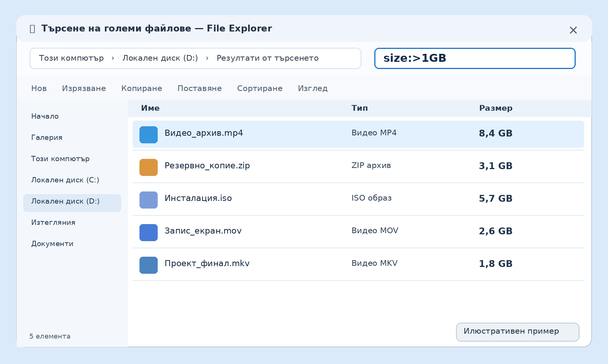
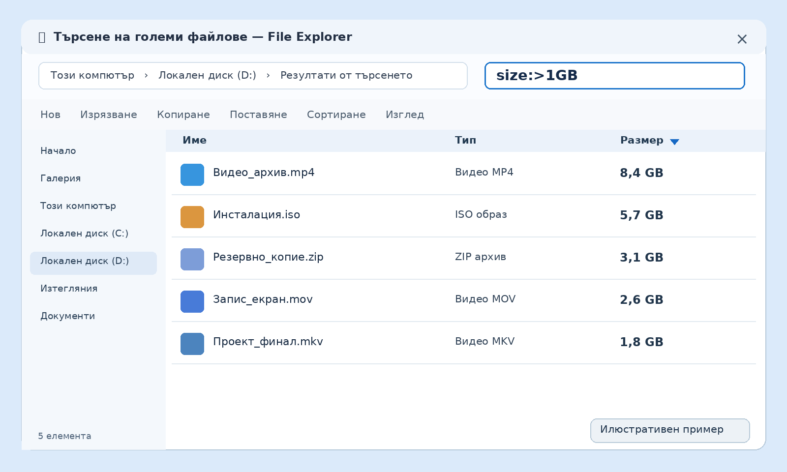

+++
title = "Кои файлове заемат най-много място на диска в Windows?"
slug = "namirane-golemi-failove-windows"
date = "2026-11-19T17:30:00.000+02:00"
author = "4s"
draft = false
description = "Научете как да откриете най-големите файлове на диска в Windows 10 и 11 чрез File Explorer и филтри по размер, без допълнителен софтуер."
tags = ["Windows 11", "Windows 10", "File Explorer", "Големи файлове", "Дисково пространство", "Търсене на файлове", "SSD"]
coverImg = "windows-search-results-with-magnifying-glass.png"
+++
Свободното пространство на диска понякога намалява с десетки гигабайти, без да е ясно къде са отишли. Причината може да бъде стар архив, голям видеофайл или забравена инсталация.

В Windows 10 и 11 можем да открием такива файлове чрез **File Explorer**, без да инсталираме допълнителни програми.

### 1. Как да намерим файлове над 1 GB?

Отворете **File Explorer** с клавишната комбинация **Win + E**.

Изберете диска, който искате да проверите, например **C:** или **D:**.

В полето за търсене, разположено горе вдясно, въведете:

`size:>1GB`

Натиснете **Enter** и изчакайте търсенето да приключи.

Windows ще потърси файлове, по-големи от 1 GB, в избраното местоположение и неговите подпапки.

Ако изберете конкретна папка вместо цял диск, търсенето ще се ограничи до нея и подпапките ѝ.

### 2. Допълнителни филтри по размер

File Explorer поддържа и други филтри, с които можем да стесним резултатите.

| Филтър          | Какво намира         |
| --------------- | -------------------- |
| `size:>500MB`   | Файлове над 500 MB   |
| `size:>1GB`     | Файлове над 1 GB     |
| `size:huge`     | Файлове от 1 до 4 GB |
| `size:gigantic` | Файлове над 4 GB     |

Например, ако търсите много големи видеофайлове или архиви, `size:gigantic` може да бъде удобен начален филтър.

**Важно:** Въвеждайте филтрите в полето за търсене на File Explorer, а не в адресната лента.

### 3. Как да подредим файловете по размер?

След приключване на търсенето превключете към изглед **Details (Подробности)** от менюто **View (Изглед)**.

Щракнете върху заглавието на колоната **Size (Размер)**, за да подредите файловете.

Ако най-големите не са отгоре, щракнете повторно, за да обърнете подредбата.

Така лесно ще забележите кои файлове заемат най-много място.

Можете да използвате **Open file location** от контекстното меню, за да проверите къде се намира конкретен файл.

### 4. Кои файлове можем да изтрием?

Не всеки голям файл е ненужен.

Стари видеоклипове, архиви, дублирани файлове и вече използвани инсталационни пакети често са подходящи кандидати за преглед.

**Не изтривайте непознати системни файлове**, особено от папките `Windows`, `Program Files` и `ProgramData`.

Файлове като `pagefile.sys` и `hiberfil.sys` също не трябва да се премахват ръчно.

За освобождаване на системно пространство използвайте **Settings → System → Storage** и наличните инструменти за почистване.

### 5. Защо някои големи файлове не се показват?

Търсенето във File Explorer невинаги показва всеки файл на диска.

Скрити или защитени системни файлове, ограничения в достъпа и настройките за индексиране могат да повлияят на резултатите.

Затова показаният списък не е пълна карта на използваното дисково пространство.

### Заключение

Филтърът `size:>1GB` е практичен начин да откриете големи файлове в Windows, а сортирането по размер ви позволява бързо да ги прегледате.

Преди да изтриете нещо, проверете предназначението му. Понякога един стар архив заема повече място от десетки обикновени документи.
