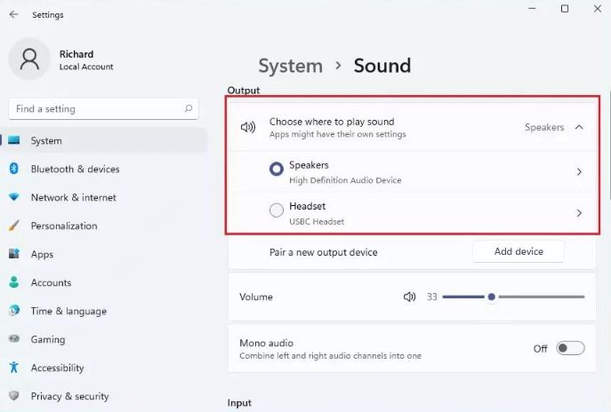
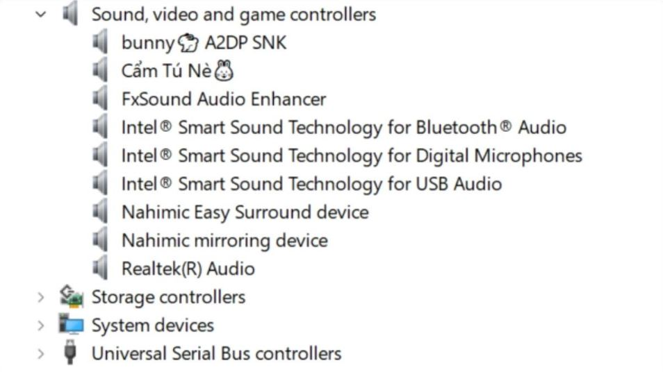

+++
title = "Няма звук на компютъра? 6 начина да решим проблема в Windows 10 и 11"
slug = "nyama-zvuk-windows"
date = "2026-10-27T13:44:00.000+02:00"
author = "4s"
draft = true
description = "Няма звук от компютъра или слушалките? Вижте 6 лесни решения за Windows 10 и 11 – настройки, Volume Mixer, аудио услуги и драйвери."
tags = ["Windows 11", "Windows 10", "Няма звук", "Аудио драйвер", "Звукови настройки", "Слушалки"]
coverImg = "main-photo22.png"
+++
Пускате видео или музика, но от компютъра не се чува нищо? Дори когато звукът е увеличен докрай?

Причината невинаги е в повредени колони или слушалки. Понякога Windows е избрал грешно устройство за възпроизвеждане, някоя програма е заглушена или има проблем с аудио драйвера.

Преди да търсите помощ от техник, опитайте следните решения.

### 1. Проверете звука и свързаните устройства

Започнете с най-очевидното. Натиснете иконата на високоговорител до часовника и проверете дали звукът не е заглушен или намален.

Ако използвате външни колони, уверете се, че са включени и кабелът е поставен правилно.

При слушалки с 3,5 мм жак опитайте да ги изключите и включите отново. Ако компютърът има няколко аудио порта, проверете дали използвате правилния.

Ако разполагате с други слушалки, свържете ги за проба. Така ще разберете дали проблемът е в компютъра или в самото устройство.

### 2. Изберете правилното устройство за звук

Windows понякога изпраща звука към друго устройство — например монитор, свързан чрез HDMI, Bluetooth слушалки или телевизор.

Отворете:

**Settings → System → Sound**

В раздела **Output (Изход)** вижте кое устройство е избрано.

Ако използвате колони, изберете тях. Ако сте със слушалки, изберете съответното устройство.

Пуснете отново музика или видео, за да проверите дали звукът се е появил.

### 3. Проверете Volume Mixer

Ако звукът работи в някои програми, но липсва в браузъра, игра или видео плейър, възможно е конкретното приложение да е заглушено.

В Windows 11 отворете:

**Settings → System → Sound → Volume mixer**

В Windows 10 можете да натиснете с десния бутон върху иконата за звук до часовника и да изберете **Open Volume mixer**.

Проверете дали съответната програма не е заглушена и дали нейният плъзгач за сила на звука не е намален.

Ако използвате Windows 11, проверете и дали приложението не е настроено да възпроизвежда звук през друго устройство.

### 4. Стартирайте инструмента за диагностика на звука

Windows има вграден инструмент, който може да открие и поправи някои проблеми със звука.

**При Windows 11:**

1. Отворете менюто **Start**.
2. Потърсете приложението **Get Help**.
3. Въведете **Audio troubleshooter**.
4. Следвайте инструкциите на екрана.

**При Windows 10:**

Отворете **Settings → Update & Security → Troubleshoot → Additional troubleshooters**.

Изберете **Playing Audio** и стартирайте диагностиката.

Ако инструментът открие проблем, следвайте предложените действия.

### 5. Рестартирайте аудио услугата на Windows

Понякога звуковата услуга на Windows спира да работи правилно. Можем да опитаме да я рестартираме, без да рестартираме целия компютър.

1. Натиснете **Win + R**.
2. Въведете `services.msc` и натиснете **Enter**.
3. В списъка намерете **Windows Audio**.
4. Натиснете с десния бутон върху услугата и изберете **Restart**.

След това проверете дали звукът работи.

Ако проблемът остава, можете да рестартирате и услугата **Windows Audio Endpoint Builder**. Това може временно да прекъсне звука в отворените приложения.

### 6. Проверете аудио драйвера

Ако нито едно от предишните решения не е помогнало, е възможно проблемът да е в драйвера на звуковото устройство.

Натиснете с десния бутон върху **Start** и изберете **Device Manager**.

Разгънете раздела:

**Sound, video and game controllers**

Намерете звуковото устройство, натиснете върху него с десния бутон и изберете **Update driver → Search automatically for drivers**.

Ако Windows открие подходящ драйвер, следвайте инструкциите и рестартирайте компютъра.

Ако не открие нов драйвер, проверете сайта на производителя на компютъра или дънната платка. Изтегляйте драйвери само от надеждни официални източници.

### А ако звукът все още не работи?

Рестартирайте компютъра, ако все още не сте го направили. Проверете и дали проблемът се появява с други слушалки или колони.

Ако Windows изобщо не открива звуково устройство или показва съобщението **„No audio output device is installed“**, вероятно е необходима допълнителна проверка на драйвера или хардуера.

Не бързайте с преинсталиране на Windows. В много случаи причината е в настройка, избрано устройство или драйвер и може да бъде отстранена без толкова крайни мерки.
