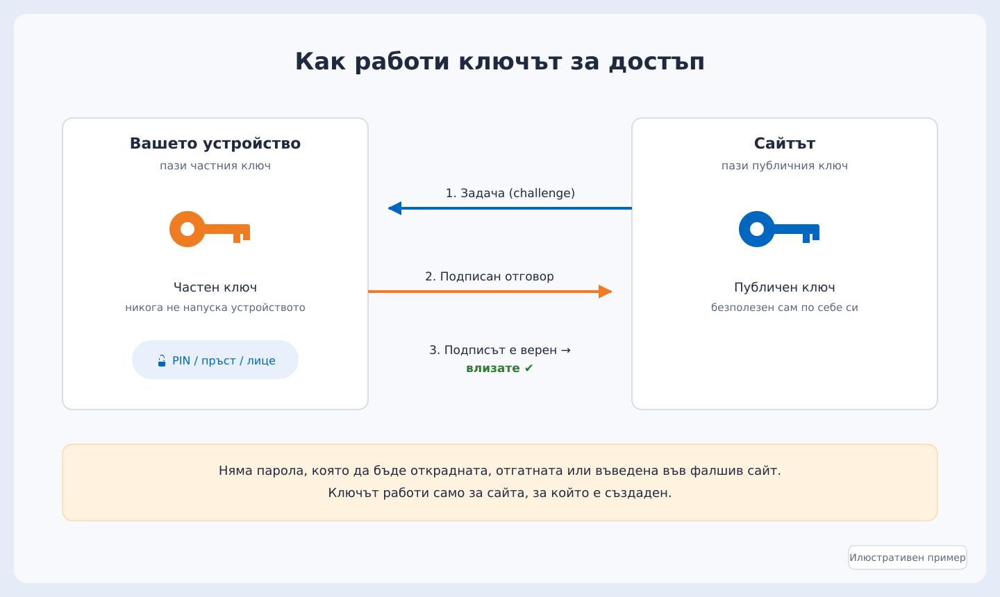
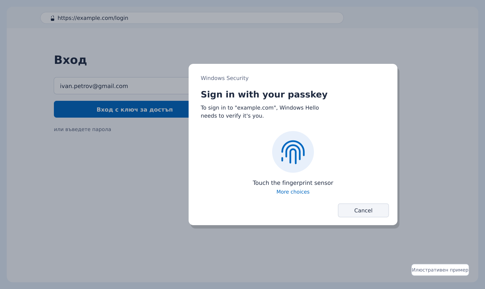
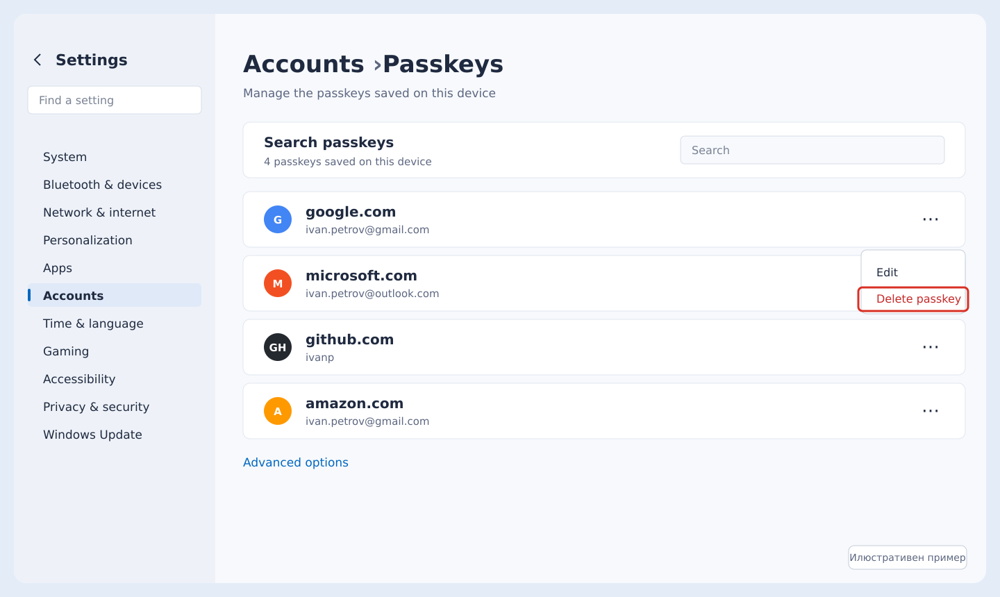
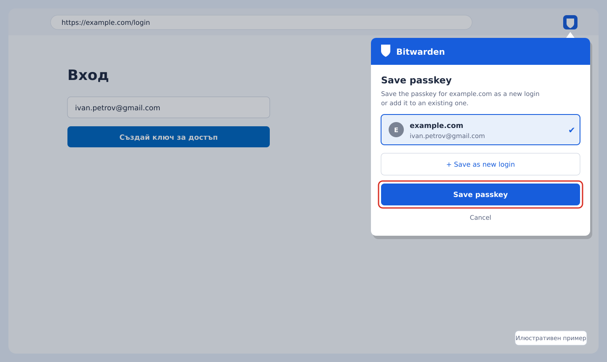
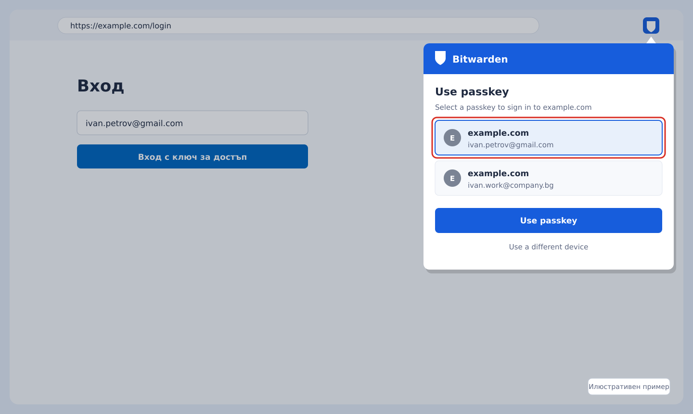

+++
title = "Passkeys: какво са ключовете за достъп и струва ли си да спрете да ползвате пароли?"
slug = "passkeys-vhod-bez-parola"
date = "2026-11-25T14:30:00.000+02:00"
author = "mos"
draft = false
description = "Какво са passkeys (ключове за достъп), как работят, защо са по-сигурни от паролите и какво да имате предвид, преди да ги включите. Как да ги управлявате в Windows 11."
tags = ["Passkeys", "Ключ за достъп", "Пароли", "Windows Hello", "Windows 11", "Сигурност", "Фишинг"]
coverImg = "main.png"
+++
Google, Microsoft, Apple, банките и онлайн магазините все по-често ви предлагат при вход: **„Създайте ключ за достъп“**. Натискате, поставяте пръст на четеца или въвеждате PIN – и следващия път влизате без парола.

Какво точно създадохте? Къде се пази? И какво става, ако загубите телефона или преинсталирате Windows?

### Какво е passkey?

**Passkey** (на български – **ключ за достъп**) е начин за влизане в акаунт без парола. Вместо низ от символи, който помните и въвеждате, устройството ви пази криптографски ключ. Отключвате го по същия начин, по който отключвате компютъра или телефона – с **пръстов отпечатък, лице или PIN**.

Технологията е разработена съвместно от Apple, Google и Microsoft в рамките на **FIDO Alliance** и е отворен стандарт (FIDO2 / WebAuthn). Затова работи в Chrome, Edge, Firefox и Safari, на Windows, Android, iPhone и Mac.

### Как работи?

Когато създадете ключ за достъп за даден сайт, устройството ви генерира **двойка ключове**:

- **Частен ключ** – остава на вашето устройство (или в мениджъра ви на пароли) и **никога не се изпраща** към сайта.
- **Публичен ключ** – изпраща се на сайта и той го запазва.

При всеки вход сайтът ви изпраща случайна „задача“. Устройството я подписва с частния ключ, след като потвърдите, че сте вие. Сайтът проверява подписа с публичния ключ и ви пуска.

PIN кодът или пръстовият ви отпечатък **не се изпращат никъде**. Те само отключват ключа на самото устройство.

### Защо е по-сигурно от паролата?

- **Защита от фишинг.** Ключът е обвързан с конкретния адрес на сайта. Ако попаднете на фалшив сайт, който изглежда като банката ви, ключът просто няма да сработи там. С паролата това не е така – можете да я въведете навсякъде.
- **Нищо за крадене при пробив.** Ако хакери откраднат базата данни на сайта, ще вземат само публични ключове. С тях не могат да влязат в акаунта ви.
- **Не може да се отгатне или преизползва.** Всеки сайт получава отделен ключ. Няма „една парола за всичко“, нито прихващане от кийлогъри.
- **По-бързо и удобно.** Не помните нищо, не въвеждате нищо и няма „Забравена парола“.

### Как изглежда на практика?

Когато сайтът поддържа ключове за достъп, на страницата за вход ще видите бутон като **„Вход с ключ за достъп“** или **„Sign in with a passkey“**. Windows отваря прозорец на **Windows Hello** и ви моли да потвърдите с пръст, лице или PIN.

Ако ключът е на телефона ви, а влизате от компютъра, Windows ще покаже **QR код**. Сканирате го с телефона, потвърждавате там и влизате на компютъра. За това е нужен включен Bluetooth и на двете устройства.

### Къде да видите ключовете си в Windows 11?

В Windows 11 отворете:

**Settings → Accounts → Passkeys**

Там са ключовете, запазени чрез Windows Hello на този компютър. Можете да ги търсите и да изтриете тези, които вече не ползвате – от менюто **⋯ → Delete passkey**.

Изтриването на ключа от компютъра **не го премахва от акаунта** в съответния сайт. Добре е да го изтриете и от настройките за сигурност на самия сайт.

### Ами ако на компютъра имам само парола?

Ако влизате в Windows само с парола – без PIN, лице или пръстов отпечатък – **Windows не може да запази ключ за достъп на компютъра**. Ключовете в Windows се пазят чрез Windows Hello, а паролата за акаунта не може да ги отключва.

Когато опитате да създадете ключ, Windows обикновено ще ви предложи да настроите Windows Hello или да използвате друго устройство. Имате няколко възможности:

- **Настройте PIN.** Това е най-лесното решение. Отворете **Settings → Accounts → Sign-in options → PIN (Windows Hello)**. PIN-ът не замества паролата на акаунта ви – той работи само на този компютър и отключва ключовете.
- **Използвайте телефона.** Ключът се пази на телефона, а при вход на компютъра сканирате QR код. Работи, но е по-бавно.
- **Използвайте хардуерен ключ**, например YubiKey, със собствен PIN.
- **Използвайте мениджър на пароли**, например Bitwarden. Той пази ключовете в своя трезор и не зависи от Windows Hello.

#### Пример: ключ за достъп с Bitwarden

Bitwarden е безплатен мениджър на пароли с отворен код, който поддържа ключове за достъп и в безплатния си план.

1. Инсталирайте разширението **Bitwarden** за вашия браузър (Chrome, Edge или Firefox) и влезте в акаунта си.
2. Отворете сайт, който поддържа ключове за достъп, и в настройките за сигурност изберете **„Създай ключ за достъп“**.
3. Вместо прозореца на Windows Hello ще се появи прозорец на Bitwarden. Изберете **Save passkey** – като нов запис или към съществуващия запис за сайта.

   

4. При следващия вход натиснете **„Вход с ключ за достъп“**. Bitwarden ще покаже запазените ключове за сайта – изберете вашия и потвърдете.

   

Ключът се отключва с **главната парола на Bitwarden** и се синхронизира на всички устройства, където използвате Bitwarden. Така не зависи нито от Windows Hello, нито от конкретния компютър.

Ако искате Windows да не се намесва, проверете в настройките на разширението дали е включена опцията Bitwarden да предлага запазване и използване на ключове за достъп. Ако пък искате ключът да се пази в Windows, а не в Bitwarden, изключете я.

Имайте предвид, че така **цялата сигурност зависи от главната парола на Bitwarden**. Изберете дълга и уникална парола и включете двуфакторна защита на самия Bitwarden акаунт.

### Какво трябва да знаете, преди да ги включите

Ключовете за достъп са по-сигурни, но имат и особености, за които малко хора споменават.

**Къде е записан ключът?** Има два вида ключове:

- **Синхронизирани** – пазят се в Google Password Manager, iCloud Keychain, мениджъра на пароли на Microsoft или в програми като Bitwarden и 1Password. Ако смените телефона или компютъра, ги получавате обратно, след като влезете в същия акаунт.
- **Привързани към устройството** – например запазените само локално в Windows Hello или на хардуерен ключ (YubiKey). Те **съществуват само на това устройство**. Ако преинсталирате Windows, смените дънната платка или загубите хардуерния ключ, губите и тях.

**Преминаването между системи е трудно.** Ключ, създаден на iPhone, не се появява автоматично в Windows или Android. Пренасянето на ключове между мениджъри все още не е стандартизирано и в повечето случаи трябва да ги създадете отново.

**Който знае PIN-а ви, може да ги ползва.** Ключът е защитен толкова, колкото и отключването на устройството ви. Не използвайте PIN като `1234` или рождената си дата.

**Паролата не изчезва веднага.** Повечето сайтове пазят паролата или имейла като резервен вариант за възстановяване. Затова пак ви трябва силна парола и включена двуфакторна защита.

### Как да ги използвате разумно

- Започнете с **най-важните акаунти** – имейл, Microsoft/Google акаунт, банка.
- Създайте ключ **на поне две устройства** – например на телефона и на компютъра. Така загубата на едното не ви заключва навън.
- Ако използвате мениджър на пароли, запазвайте ключовете **там**, за да се синхронизират.
- Запишете **кодовете за възстановяване**, които сайтът ви дава, и ги пазете извън компютъра.
- Ако продавате или преинсталирате компютъра, проверете кои ключове са били само на него и създайте нови.

### Струва ли си?

Да – за повечето хора ключовете за достъп са **по-сигурни и по-удобни от паролите**. Те решават най-честия проблем – фишинга и откраднатите пароли – без да изискват нищо повече от пръст или PIN.

Важно е само да знаете къде се пази всеки ключ и да имате резервен начин за вход. Тогава паролите наистина могат да останат в миналото.
