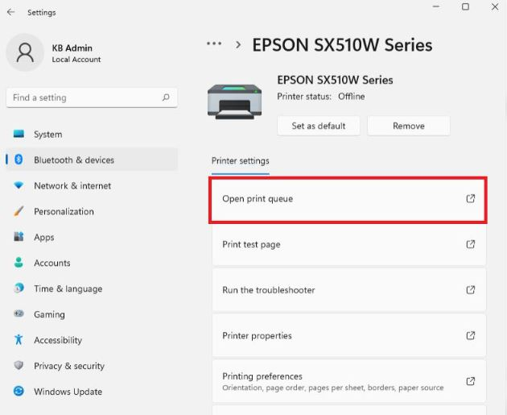
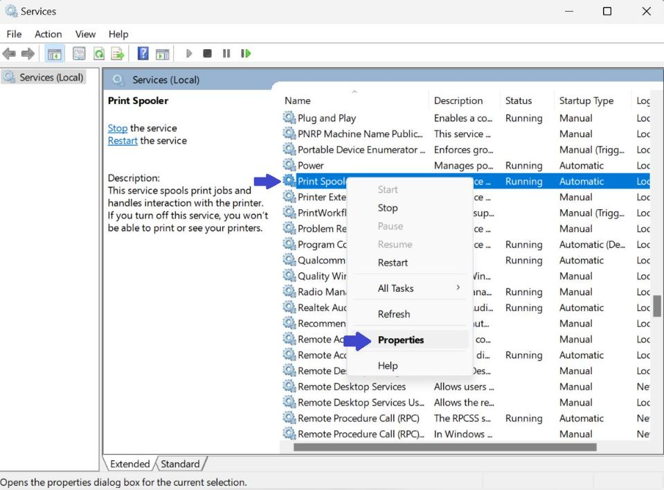

+++
title = "Принтерът не печата? Какво да проверим, преди да потърсим техник"
slug = "printer-ne-pechata-windows"
date = "2026-11-03T10:19:00.000+02:00"
author = "4s"
draft = true
description = "Принтерът не печата или показва Offline? Проверете връзката, опашката за печат, Print Spooler и драйверите в Windows 10 и 11."
tags = ["Принтер", "Windows 11", "Windows 10", "Print Spooler", "Опашка за печат", "Printer Offline", "Драйвери"]
coverImg = "main-photo.png"
+++
Натискате Print, но принтерът не реагира? Документът стои в опашката за печат, а понякога Windows дори показва, че устройството е Offline?

Преди да търсите техник, има няколко неща, които можете да проверите сами. Често причината е в прекъсната връзка, блокирал документ или настройка на Windows.

Ето откъде да започнете.

### 1. Проверете самия принтер

Първо вижте дали принтерът е включен и готов за работа.

Проверете дали има хартия, дали не е заседнал лист и дали на дисплея или индикаторите няма съобщение за грешка.

При мастиленоструйните принтери проверете и нивото на мастилото, а при лазерните — състоянието на тонера.

Ако всичко изглежда наред, изключете принтера, извадете захранващия кабел за около 30 секунди и го включете отново.

Понякога това е достатъчно, за да възстановите нормалната му работа.

### 2. Проверете връзката с компютъра

Ако принтерът е свързан с USB кабел, проверете дали кабелът е поставен добре и в двата края.

Можете да опитате и друг USB порт.

При Wi-Fi принтер проверете дали е свързан към безжичната мрежа и дали компютърът използва същата мрежа.

Ако принтерът е мрежов, а останалите устройства печатат нормално през него, вероятно причината е в конкретния компютър.

### 3. Проверете дали Windows не е избрал друг принтер

Ако имате няколко инсталирани принтера, е възможно документът да се изпраща към грешното устройство.

В Windows 11 отворете:

**Settings → Bluetooth & devices → Printers & scanners**

При Windows 10:

**Settings → Devices → Printers & scanners**

Намерете желания принтер и проверете дали е избран при отпечатването.

Обърнете внимание и на състоянието му. Ако Windows го показва като **Offline**, проверете връзката и дали не е включена опцията **Use Printer Offline** в опашката за печат.

При някои версии на Windows тази опция се намира в менюто **Printer**.

### 4. Изчистете опашката за печат

Понякога един блокирал документ може да спре отпечатването на всички следващи.

Отворете **Printers & scanners**, изберете вашия принтер и натиснете:

**Open print queue**

Ще видите документите, които чакат да бъдат отпечатани.

Ако има заседнали задания, изберете ги и натиснете **Cancel**.

След като опашката се изчисти, опитайте да отпечатате документа отново.

Ако заданията отказват да се премахнат, преминете към следващата стъпка.

### 5. Рестартирайте Print Spooler

Print Spooler е услуга на Windows, която управлява документите, изпратени за печат.

Когато тя блокира, принтерът може да спре да печата, въпреки че е свързан правилно.

За да я рестартирате:

1. Натиснете **Win + R**.
2. Въведете `services.msc` и натиснете **Enter**.
3. В списъка намерете **Print Spooler**.
4. Натиснете с десния бутон върху услугата.
5. Изберете **Restart**.

   

След това опитайте да отпечатате тестова страница.

**Важно:** Рестартирането на услугата може да прекъсне текущите задания за печат. Ако използвате споделен принтер, имайте предвид, че действието засяга опашките, управлявани от този компютър.

Ако искате по-подробни инструкции, вижте и нашето ръководство: [Как да рестартираме Print Spooler в Windows](https://cursor.bg/posts/spooler-restart/).

### 6. Проверете драйвера на принтера

Ако принтерът все още не работи, възможно е проблемът да е в неговия драйвер.

Отворете **Start**, напишете `Device Manager` и стартирайте приложението.

Намерете принтера в раздела **Printers** или **Print queues**, ако присъства там.

Натиснете с десния бутон върху устройството и изберете:

**Update driver → Search automatically for drivers**

Ако Windows не открие подходящ драйвер, посетете официалния сайт на производителя — например HP, Canon, Brother или Epson.

Изберете точния модел и версията на Windows, която използвате.

Избягвайте случайни сайтове и програми, които обещават автоматично да поправят всички драйвери.

### А ако принтерът все още не печата?

Опитайте да отпечатате тестова страница от настройките на принтера в Windows.

Ако тестовата страница се отпечатва, но документите от Word или друга програма не излизат, е възможно проблемът да е в конкретното приложение или файл.

Ако принтерът не печата дори собствената си тестова страница, проверете съобщенията на устройството и инструкциите на производителя.

Не бързайте да преинсталирате Windows или да възстановявате фабричните настройки на принтера.

В повечето случаи е по-разумно първо да проверите връзката, опашката за печат и драйвера.
