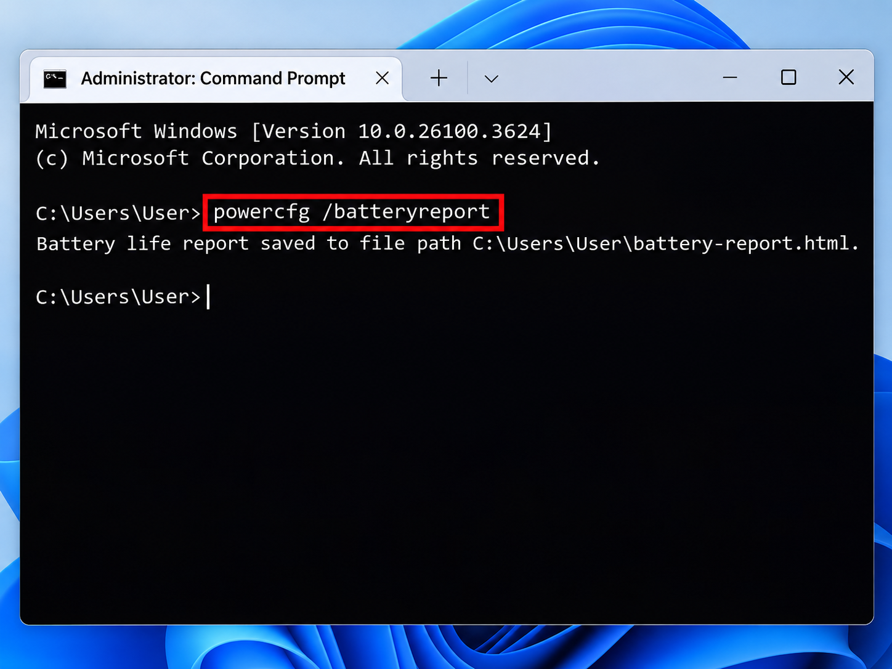
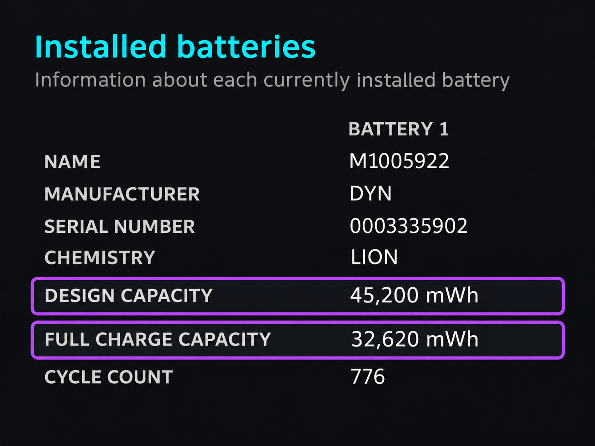
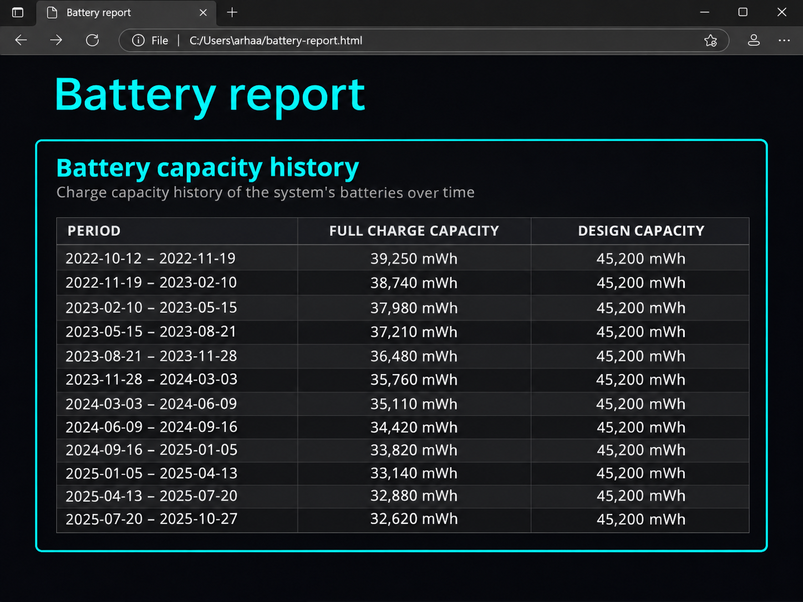

+++
title = "Как да проверим състоянието на батерията на лаптопа в Windows"
slug = "proverka-bateria-laptop-windows"
date = "2026-11-09T20:30:00.000+02:00"
author = "4s"
draft = false
description = "Проверете състоянието и износването на батерията на лаптопа в Windows 10 и 11 с командата powercfg /batteryreport, без допълнителни програми."
tags = ["Windows 11", "Windows 10", "Батерия на лаптоп", "Проверка на батерия", "Battery Report", "powercfg", "Износване на батерия"]
coverImg = "main-photo.png"
+++
Батерията на лаптопа издържа все по-малко, въпреки че я зареждате до 100%? Това невинаги означава, че е повредена. С времето всяка батерия постепенно губи част от първоначалния си капацитет.

Windows разполага с вграден инструмент, който може да покаже състоянието на батерията, историята на използването ѝ и колко заряд е способна да съхранява.

Не е необходимо да инсталирате допълнителни програми. Достатъчна е една команда.

### 1. Как да създадем отчет за батерията?

Отворете менюто **Start** и потърсете **Command Prompt** или `cmd`.

Натиснете с десния бутон върху приложението и изберете **Run as administrator**.

Въведете командата:

`powercfg /batteryreport`

Натиснете **Enter**.

Windows ще генерира HTML отчет и ще покаже къде е записан файлът.

Например:

`C:\Users\YourName\battery-report.html`

Точното местоположение може да е различно, затова използвайте адреса, показан в Command Prompt.

Командата работи в Windows 10 и Windows 11.

### 2. Как да отворим отчета?

Отворете **File Explorer** и поставете адреса на файла в адресната лента.

Натиснете **Enter**.

Отчетът ще се отвори в браузъра ви, например Microsoft Edge или Google Chrome.

В него ще видите информация за батерията, нейния капацитет, използването през последните дни и наличната история на зареждането.

Най-важната за нас секция е **Installed batteries**.

### 3. Какво означават Design Capacity и Full Charge Capacity?

В секцията **Installed batteries** потърсете следните два показателя:

**Design Capacity** – първоначалният капацитет, за който е проектирана батерията.

**Full Charge Capacity** – приблизителният максимален заряд, който батерията може да съхрани в момента според данните, предоставени на Windows.

Стойностите обикновено са посочени в **mWh** (миливатчаса).

Например:

| Показател            | Стойност   |
| -------------------- | ---------- |
| Design Capacity      | 50 000 mWh |
| Full Charge Capacity | 40 000 mWh |

В този пример батерията може да съхранява приблизително 80% от първоначалния си капацитет.

Това означава около 20% загуба на капацитет спрямо проектната стойност.

**Важно:** Тези показатели са оценки, предоставени от системата за управление на батерията. Те не са лабораторно измерване и не винаги отразяват абсолютно точно физическото ѝ състояние.

### 4. Как да изчислим износването на батерията?

За да изчислите приблизително колко от първоначалния капацитет е останал, разделете **Full Charge Capacity** на **Design Capacity** и умножете по 100.

**Оставащ капацитет (%) = Full Charge Capacity ÷ Design Capacity × 100**

Използвайки стойностите от примера:

`40 000 ÷ 50 000 × 100 = 80%`

Следователно:

* Оставащ капацитет: **80%**
* Приблизителна загуба на капацитет: **20%**

Това не означава, че батерията е заредена на 80%.

**Зарядът и състоянието на батерията са различни неща.** Лаптопът може да показва 100% заряд, но батерията вече да съхранява по-малко енергия, отколкото когато е била нова.

### 5. Как да проверим дали капацитетът намалява с времето?

В отчета потърсете секцията **Battery capacity history**.

Тя показва как са се променяли отчетените стойности на капацитета през различни периоди.

Ако **Full Charge Capacity** постепенно намалява, това обикновено е признак за естествено стареене на батерията.

Имайте предвид, че отчетените стойности понякога могат да се колебаят заради температурни условия, преизчисляване на капацитета или особености на контролера.

Не правете заключение само по една стойност. По-полезно е да разгледате тенденцията за по-дълъг период, ако разполагате с достатъчно данни.

### 6. Колко време действително издържа батерията?

Отворете секцията **Battery life estimates**.

Тук Windows показва приблизителни оценки за времето на работа, базирани на отчетеното използване на батерията.

Можете да сравните очакваното време при текущия капацитет с оценката при първоначалния капацитет.

Реалната издръжливост обаче зависи и от други фактори:

* Яркостта на екрана.
* Натоварването на процесора и видеокартата.
* Работещите програми.
* Wi-Fi и Bluetooth устройствата.
* Настройките за захранване.

Затова дори батерия с добър капацитет може да се изтощава бързо, ако лаптопът работи под високо натоварване.

### 7. Кога е време за смяна на батерията?

Няма една универсална стойност, при която всички батерии задължително трябва да бъдат сменени.

Ако капацитетът е намалял значително, но лаптопът все още издържа достатъчно дълго за вашите нужди, не е задължително да предприемате незабавна смяна.

По-сериозни признаци са:

* Лаптопът се изключва неочаквано, въпреки че показва оставащ заряд.
* Батерията издържа необичайно кратко време.
* Windows или производителят предупреждава за влошено състояние.
* Батерията е видимо подута.

**Внимание:** Ако батерията е подута, прекратете използването на лаптопа и потърсете квалифицирана техническа помощ. Не я притискайте, пробивайте или разглобявайте.

### Как да удължим живота на батерията?

Литиево-йонните батерии се износват естествено, но няколко навика могат да забавят този процес.

* Избягвайте продължително излагане на високи температури.
* Не оставяйте лаптопа да се разрежда до 0% редовно.
* Когато е практично, поддържайте умерен заряд, например около 20–80%.
* Ако производителят предлага ограничение на зареждането до 80%, можете да използвате тази функция.
* Поддържайте охлаждането на лаптопа в добро състояние.

Не е необходимо непрекъснато да следите процента. Целта е да избягвате продължително загряване и крайни състояния на зареждане, когато това е възможно.

### Заключение

С командата `powercfg /batteryreport` можете бързо да получите полезна информация за батерията на своя лаптоп, без да инсталирате допълнителен софтуер.

Сравнете **Design Capacity** и **Full Charge Capacity**, разгледайте историята на капацитета и проверете оценките за времето на работа.

Така ще добиете по-добра представа дали батерията е естествено износена, или кратката ѝ издръжливост може да се дължи и на начина, по който използвате компютъра.
