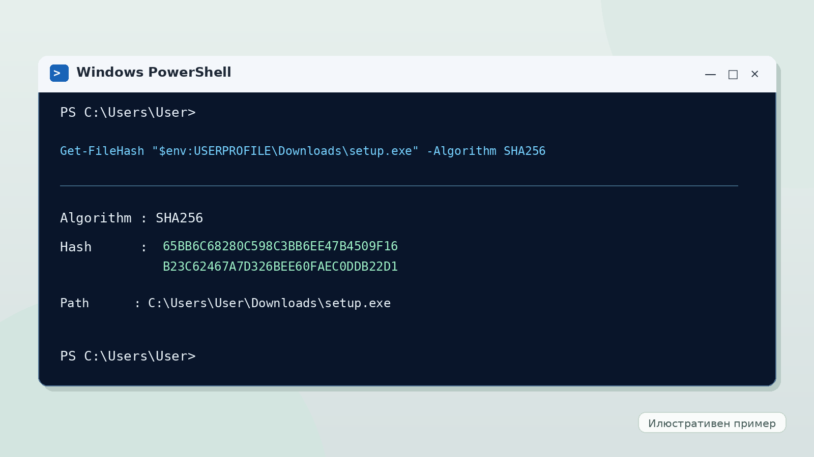
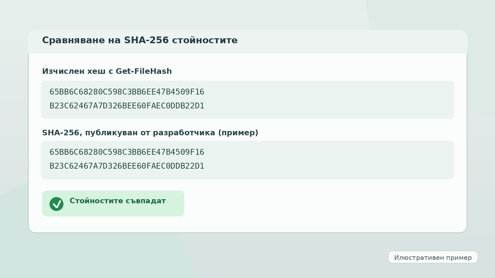

+++
title = "Как да проверим дали изтеглен файл е оригинален с една команда?"
slug = "proverka-fail-sha256-windows"
date = "2026-11-16T17:50:00.000+02:00"
author = "4s"
draft = true
description = "Научете как да проверите SHA-256 хеша на изтеглен файл в Windows 10 и 11 с Get-FileHash и да го сравните с оригиналната стойност от разработчика."
tags = ["Windows 11", "Windows 10", "PowerShell", "SHA256", "Get-FileHash", "Проверка на файлове", "Сигурност", "Диагностика"]
+++
Изтеглили сте програма, драйвер, ISO файл или архив от интернет, но искате да проверите дали съдържанието му е същото като публикуваното от разработчика?

В Windows 10 и 11 можете да направите това без допълнителни програми, като използвате **PowerShell** и командата `Get-FileHash`.

Тя изчислява цифров отпечатък на файла, наречен **хеш**, който може да бъде сравнен с официално публикувана стойност.

### 1. Как да проверим SHA-256 хеша на файл?

Отворете менюто **Start**, потърсете **Windows PowerShell** и го стартирайте.

Въведете следната команда:

`Get-FileHash "$env:USERPROFILE\Downloads\setup.exe" -Algorithm SHA256`

Заменете **setup.exe** с името на файла, който искате да проверите.

Ако той се намира в друга папка, можете да посочите пълния му адрес в кавички.

Натиснете **Enter**.

PowerShell ще изчисли хеша и ще покаже резултат с три основни полета:

**Algorithm** – използваният алгоритъм, в нашия случай SHA256.

**Hash** – изчисленият цифров отпечатък на файла.

**Path** – местоположението на проверения файл.

Проверката не променя съдържанието на файла.

### 2. Как да разберем дали файлът е оригинален?

Посетете официалния сайт на разработчика и потърсете публикуваната **SHA-256 checksum** стойност за точната версия на изтегления файл.

Сравнете я с резултата от PowerShell.

| Резултат             | Какво означава                                      |
| -------------------- | --------------------------------------------------- |
| Хешовете съвпадат    | Файлът съответства на публикувания цифров отпечатък |
| Хешовете са различни | Съдържанието не съответства на очаквания файл       |
| Няма официален хеш   | Нямате надеждна стойност за сравнение               |

Дори промяна на малка част от файла обикновено води до напълно различен SHA-256 хеш.

**Важно:** Съвпадението показва, че файлът отговаря на проверяваната стойност, но не доказва само по себе си, че програмата е безопасна.

Използвайте хешове от доверен официален източник. Ако файлът и хешът идват от един и същ компрометиран сайт, проверката може да бъде подвеждаща.

### 3. Можем ли да сравним два файла?

Да. Ако разполагате с две копия на един файл, можете да проверите дали съдържанието им е еднакво.

Изпълнете `Get-FileHash` за всеки файл поотделно и сравнете стойностите в полето **Hash**.

Ако SHA-256 хешовете съвпадат, имате много силно основание да приемете, че файловете са идентични по съдържание.

Имената им могат да бъдат различни – хешът зависи от съдържанието, а не от името на файла.

### Заключение

Командата `Get-FileHash` е лесен начин да проверите целостта на изтеглени програми, архиви и ISO файлове.

Най-полезна е, когато разработчикът публикува официален SHA-256 хеш, с който можете да сравните получения резултат.

Така проверявате дали файлът съответства на очакваното съдържание, без да инсталирате допълнителен софтуер.
