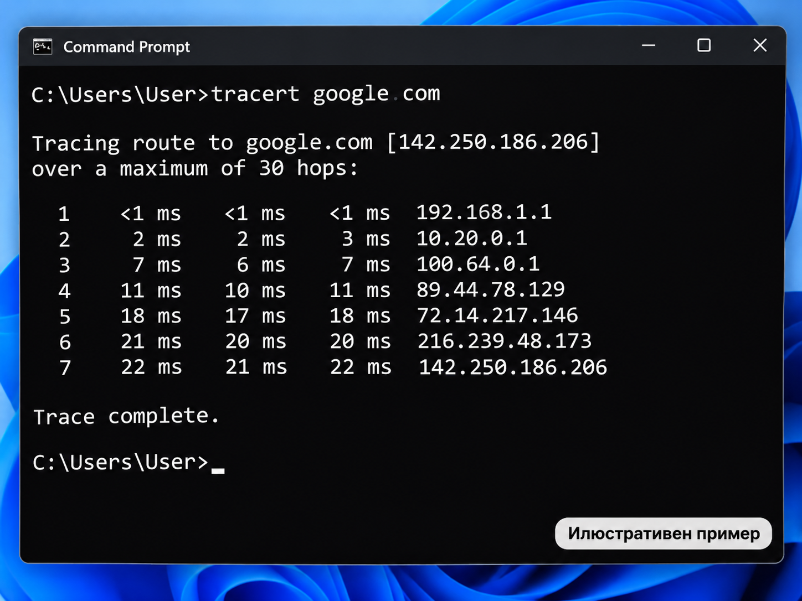
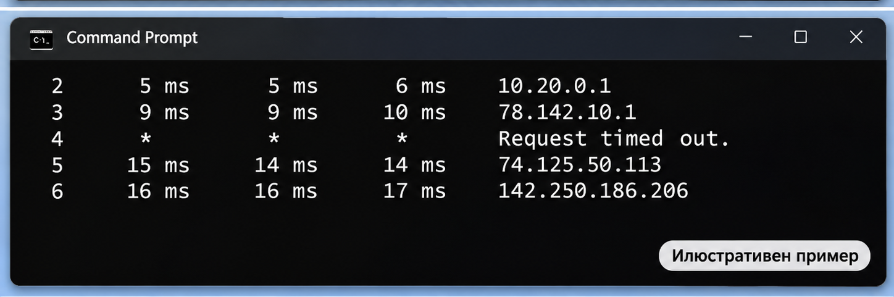

+++
title = "Интернетът прекъсва? Проследете мрежовия маршрут с tracert"
slug = "proverka-internet-vrazka-tracert"
date = "2026-11-23T20:30:00.000+02:00"
author = "4s"
draft = false
description = "Научете как да използвате tracert в Windows 10 и 11, да проследите мрежовия маршрут и да разчетете времената за отговор и Request timed out."
tags = ["Windows 11", "Windows 10", "tracert", "Интернет връзка", "Мрежова диагностика", "Command Prompt", "Troubleshooting"]
coverImg = "traceroute-command-center.png"
+++
Понякога интернет връзката работи, но определени сайтове се зареждат бавно или изобщо не се отварят. Причината невинаги е в домашния рутер — проблемът може да се намира и по мрежовия маршрут до сървъра.

В Windows 10 и 11 можем да използваме вградената команда **tracert**, която показва през кои маршрутизатори преминават диагностичните заявки до избран адрес.

### 1. Как да проверим маршрута до даден сайт?

Отворете менюто **Start**, напишете `cmd` и стартирайте **Command Prompt**.

Въведете следната команда:

`tracert google.com`

Натиснете **Enter** и изчакайте резултатите.

Windows ще започне да показва отделните стъпки по маршрута към посочения сървър. Всяка стъпка се нарича **hop** и обикновено представлява маршрутизатор или друго мрежово устройство.

Командата по подразбиране проверява до 30 стъпки, освен ако дестинацията не бъде достигната по-рано.

### 2. Как да разчитаме резултатите?

Всеки ред започва с номер на стъпката, последван от три измервания на времето за отговор и IP адрес или име на устройството.

Например:

| Стъпка | Отговор | Адрес        |
| ------ | ------- | ------------ |
| 1      | 1 ms    | 192.168.1.1  |
| 2      | 8 ms    | 10.20.0.1    |
| 3      | 14 ms   | 198.51.100.1 |

Стойностите са в **милисекунди (ms)** и показват времето за отиване и връщане на диагностичния пакет.

Първата стъпка в домашна мрежа често е локалният рутер. Следващите могат да принадлежат на интернет доставчика или на други мрежи.

**Важно:** Еднократно високо време за отговор на междинна стъпка не доказва проблем. Маршрутизаторите могат да обработват диагностичните заявки с по-нисък приоритет.

### 3. Какво означава Request timed out?

Понякога вместо стойности ще видите:

`* * * Request timed out.`

Това означава, че командата не е получила очаквания отговор в зададеното време.

**Не означава непременно, че интернет връзката е прекъсната.**

Някои маршрутизатори ограничават или не изпращат отговори на подобни заявки, въпреки че продължават да препращат мрежовия трафик.

Ако след ред със звездички се появят следващи успешни стъпки, маршрутът очевидно продължава.

### 4. Как да ускорим проверката?

Използвайте командата:

`tracert -d google.com`

Параметърът **\-d** пропуска опитите за преобразуване на IP адресите на междинните устройства в DNS имена.

Това често ускорява показването на резултатите.

### 5. Какво да проверим при съмнение за проблем?

Ако имате затруднения с конкретен сайт, сравнете резултата от `tracert` към него с резултат към друг достъпен адрес.

Можете да проверите и локалния рутер с `ping 192.168.1.1`, ако това действително е неговият IP адрес.

Ако има забавяне още към рутера, проверете Wi-Fi сигнала, мрежовия кабел или локалното оборудване.

Ако проблемът изглежда извън домашната мрежа, запазете резултата и го предоставете на интернет доставчика.

Имайте предвид, че **tracert не е пълен тест за скорост или загуба на пакети**.

### Заключение

Командата `tracert` помага да проследим мрежовия маршрут и да получим ориентир къде може да възниква затруднение при достигане до даден сървър.

Тя е полезна първа стъпка при диагностика, но резултатите трябва да се тълкуват внимателно, особено когато се появяват звездички или отделни високи времена за отговор.
