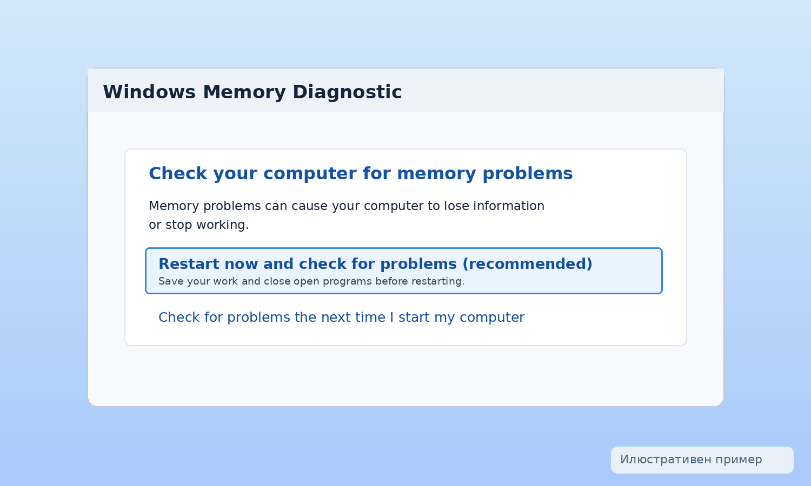
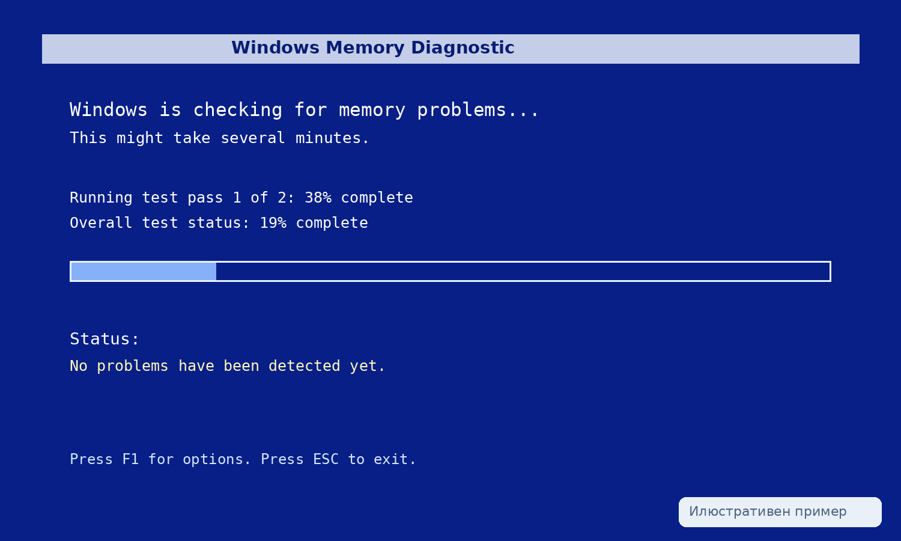
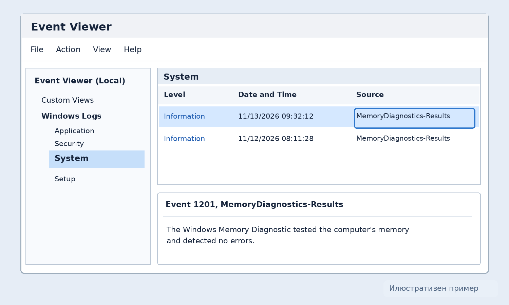

+++
title = "Как да проверим RAM паметта за грешки в Windows"
slug = "proverka-ram-pamet-windows"
date = "2026-11-12T19:30:00.000+02:00"
author = "4s"
draft = true
description = "Проверете RAM паметта за грешки в Windows 10 и 11 с командата mdsched.exe. Научете как да стартирате теста и да намерите резултатите в Event Viewer."
tags = ["Windows 11", "Windows 10", "RAM памет", "Windows Memory Diagnostic", "mdsched", "Диагностика", "Хардуер", "Син екран"]
coverImg = "windows-memory-diagnostic-results.png"
+++
Компютърът забива без видима причина, рестартира се неочаквано или понякога показва син екран? Една от възможните причини е нестабилна или дефектна оперативна памет (RAM).

Windows разполага с вграден инструмент, наречен **Windows Memory Diagnostic**, с който можем да проверим паметта, без да инсталираме допълнителен софтуер.

Инструментът се стартира с една команда, а проверката се извършва при рестартиране на компютъра.

### 1. Как да стартираме проверката на RAM паметта?

Преди всичко запазете отворените документи и затворете работещите програми, защото тестът изисква рестартиране.

Натиснете **Win + R**, за да отворите прозореца Run.

Въведете командата:

`mdsched.exe`

Натиснете **Enter**.

Ще се появи прозорец **Windows Memory Diagnostic**, който предлага два варианта:

**Restart now and check for problems (recommended)** – рестартира компютъра и започва проверката веднага.

**Check for problems the next time I start my computer** – отлага проверката до следващото стартиране на компютъра.

Ако сте запазили работата си и можете да рестартирате устройството, изберете първия вариант.

### 2. Как протича самият тест?

След рестартирането Windows ще зареди специален диагностичен екран, преди да стартира операционната система.

Там ще видите надпис **Windows Memory Diagnostic Tool**, информация за напредъка на проверката и състоянието на теста.

По подразбиране инструментът използва режим **Standard**, който изпълнява набор от проверки на оперативната памет.

Продължителността зависи от обема на RAM паметта, избраните настройки и производителността на компютъра.

По време на проверката не изключвайте устройството принудително.

След приключване Windows обикновено рестартира компютъра автоматично и се връща към нормалното зареждане.

### 3. Каква е разликата между Standard и Extended?

Windows Memory Diagnostic предлага няколко режима на проверка.

| Режим    | Предназначение                                  |
| -------- | ----------------------------------------------- |
| Basic    | По-кратък набор от тестове                      |
| Standard | Стандартна проверка, избрана по подразбиране    |
| Extended | Допълнителни тестове за по-задълбочена проверка |

Ако стандартната проверка не открие грешки, но компютърът продължава да забива или показва сини екрани, можете да опитате и режима **Extended**.

Докато диагностиката работи, натиснете **F1**, за да отворите настройките.

В полето **Test Mix** изберете **Extended** с клавишите със стрелки.

Натиснете **F10**, за да приложите настройката и да продължите теста.

Режимът Extended може да отнеме значително повече време. Не е необходимо да го използвате при всяка профилактична проверка.

### 4. Къде да намерим резултатите след рестартиране?

След като Windows се зареди и влезете в профила си, може да се появи известие с резултата от диагностиката.

Ако не видите такова известие, можете да проверите резултатите чрез **Event Viewer**.

Натиснете **Win + R** и въведете:

`eventvwr.msc`

Натиснете **Enter**.

В лявата част на прозореца отворете:

**Windows Logs → System**

В дясната част изберете **Find...** и потърсете:

`MemoryDiagnostics-Results`

Отворете най-новото съответстващо събитие и проверете датата, часа и описанието му.

Ако Windows не е открил грешки, обикновено ще видите съобщение, че паметта е тествана и не са установени проблеми.

В някои версии и конфигурации допълнителни диагностични записи могат да се намират и в:

**Applications and Services Logs → Microsoft → Windows → MemoryDiagnostics-Results**

Точните налични журнали и записи могат да се различават според версията на Windows.

### 5. Какво означава резултатът?

След приключване на проверката има два основни сценария.

**Не са открити грешки.** Това означава, че диагностиката не е установила проблем при извършените тестове. Не е абсолютна гаранция, че RAM паметта е напълно изправна.

**Открити са хардуерни грешки.** Това е сериозен сигнал, че оперативната памет или свързана с нея настройка или хардуерен компонент може да е нестабилен.

Причината невинаги е дефектен RAM модул.

Нестабилни настройки на паметта, несъвместимост между компоненти или проблем с контролера на паметта също могат да доведат до грешки.

Затова е добре резултатът да се разглежда заедно със симптомите на компютъра.

### 6. Какво да направим, ако тестът открие грешки?

Ако Windows Memory Diagnostic открие проблем, първо архивирайте важните си файлове, особено ако компютърът забива често.

Ако наскоро сте добавили RAM памет, проверете дали новият модул е съвместим с дънната платка и останалите компоненти.

При използване на XMP или EXPO профил за паметта може да проверите дали системата работи стабилно със стандартните настройки, съобразно документацията на производителя.

Ако компютърът разполага с няколко RAM модула, проверката на всеки модул поотделно може да помогне да се установи откъде идва проблемът.

**Важно:** Не разглобявайте лаптоп или настолен компютър, ако нямате необходимия опит. Изключете устройството от захранването и следвайте инструкциите на производителя или потърсете техник.

Ако грешките продължават, може да е необходима допълнителна хардуерна диагностика.

### 7. Може ли RAM паметта да е проблемна, ако тестът не открие грешки?

Да. Някои неизправности се проявяват само при определено натоварване, температура или комбинация от системни настройки.

Windows Memory Diagnostic е полезна първоначална проверка, но не открива непременно всички възможни проблеми.

Ако компютърът продължава да забива, можете да проверите и историята на системните грешки.

С командата `perfmon /rel` се отваря **Reliability Monitor**, който показва регистрираните сривове на приложения и Windows.

Така можете да сравните кога са започнали проблемите и дали съвпадат с промени по хардуера или инсталирани драйвери.

### Заключение

С командата `mdsched.exe` можете да проверите RAM паметта на компютъра, без да инсталирате допълнителен софтуер.

Започнете със стандартния тест, а при продължаващи симптоми обмислете режима Extended.

След приключване на проверката разгледайте резултатите в Event Viewer и не правете заключение за повреден компонент само въз основа на един симптом.

Windows Memory Diagnostic е добра първа стъпка при диагностика на случайни забивания, неочаквани рестартирания и сини екрани.
