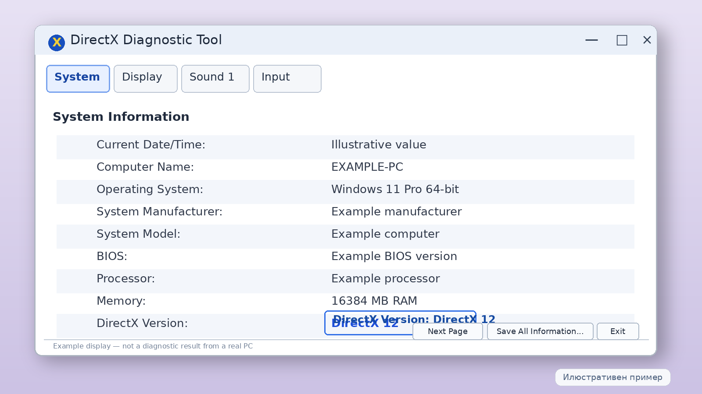
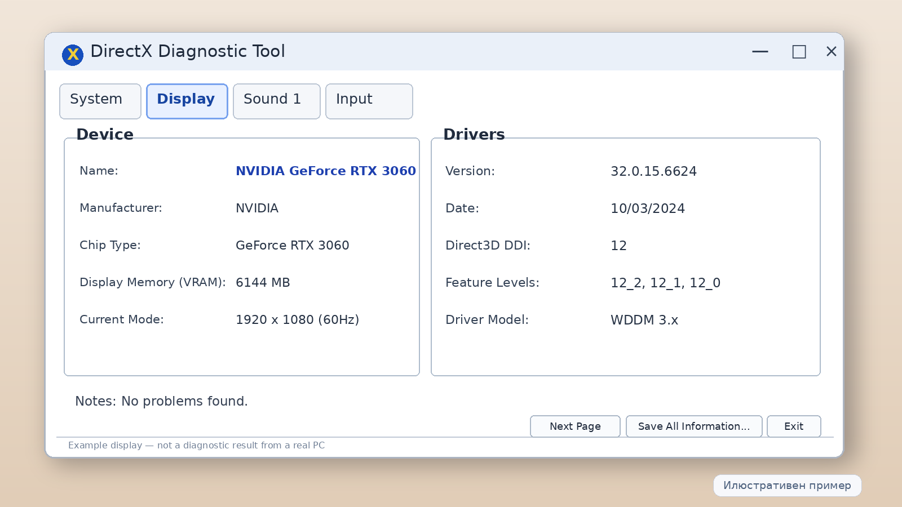

+++
title = "Как да проверим видеокартата и DirectX с една команда?"
slug = "proverka-videokarta-dxdiag"
date = "2026-11-15T18:30:00.000+02:00"
author = "4s"
draft = true
description = "Проверете модела на видеокартата, версията на драйвера и DirectX с командата dxdiag в Windows 10 и 11. Вижте как да запазите диагностичен отчет."
tags = ["Windows 11", "Windows 10", "dxdiag", "DirectX", "Видеокарта", "Графични драйвери", "Диагностика", "Игри"]
coverImg = "directx-diagnostic-tool-on-windows-11.png"
+++
Искате да разберете какъв модел е видеокартата ви, коя версия на графичния драйвер използвате или какъв DirectX е инсталиран?

Windows 10 и 11 разполагат с вграден инструмент, наречен **DirectX Diagnostic Tool**, който показва тази информация без допълнителен софтуер.

Той е особено полезен, когато игра не стартира, появяват се графични грешки или техническата поддръжка поиска информация за компютъра.

### 1. Как да отворим DirectX Diagnostic Tool?

Натиснете **Win + R**, за да отворите прозореца Run.

Въведете командата:

`dxdiag`

Натиснете **Enter**.

При първото стартиране Windows може да попита дали искате да провери цифровите подписи на драйверите. Можете да изберете **Yes**.

Ще се отвори прозорецът **DirectX Diagnostic Tool**, който съдържа информация за системата, видеокартата, звуковите устройства и свързаните с тях драйвери.

### 2. Как да проверим версията на DirectX?

Отворете раздела **System**.

В долната част на секцията **System Information** намерете:

**DirectX Version** – показва версията на DirectX, налична в Windows.

Например може да видите **DirectX 12**.

Важно е да знаете, че тази стойност не означава непременно, че видеокартата поддържа всички функции на DirectX 12.

За съвместимостта с конкретни графични функции значение имат и възможностите на видеокартата, драйверът и поддържаните **Feature Levels**.

### 3. Къде да видим модела на видеокартата и драйвера?

Изберете раздела **Display**.

В секцията **Device** потърсете полето **Name**. То показва модела на съответния графичен адаптер.

В секцията **Drivers** можете да откриете версията и датата на драйвера, както и информация за графичните функции, които той поддържа.

| Показател             | Какво означава                      |
| --------------------- | ----------------------------------- |
| Name                  | Модел на графичния адаптер          |
| Manufacturer          | Производител                        |
| Display Memory (VRAM) | Видео памет, отчетена за адаптера   |
| Version               | Версия на графичния драйвер         |
| Driver Date           | Дата на драйвера                    |
| Feature Levels        | Поддържани нива на графични функции |

При компютри с вградена и отделна видеокарта може да има повече от един раздел **Display** или допълнителен раздел **Render**.

Проверете всеки от тях, ако търсите конкретен графичен адаптер.

В полето **Notes** инструментът може да показва информация за установени проблеми. Липсата на съобщение за грешка обаче не гарантира, че видеокартата работи безупречно.

### 4. Как да запазим диагностичен отчет?

Ако трябва да изпратите информацията на техническа поддръжка, натиснете бутона **Save All Information...** в долната част на прозореца.

Изберете папка и запазете отчета като текстов файл, например:

`DxDiag.txt`

Файлът съдържа подробности за системата, видеокартата, драйверите и другите устройства, описани от инструмента.

**Важно:** Преди да изпратите отчета, прегледайте го. Той може да съдържа името на компютъра и друга системна информация.

### Заключение

Командата `dxdiag` е бърз начин да проверите видеокартата, версията на DirectX и графичния драйвер в Windows 10 и 11.

Инструментът не поправя автоматично проблемите, но предоставя полезна информация при диагностика на игри, графични грешки и проблеми със съвместимостта.

А когато се нуждаете от по-подробна системна информация, можете да използвате и вградения инструмент `msinfo32`.
