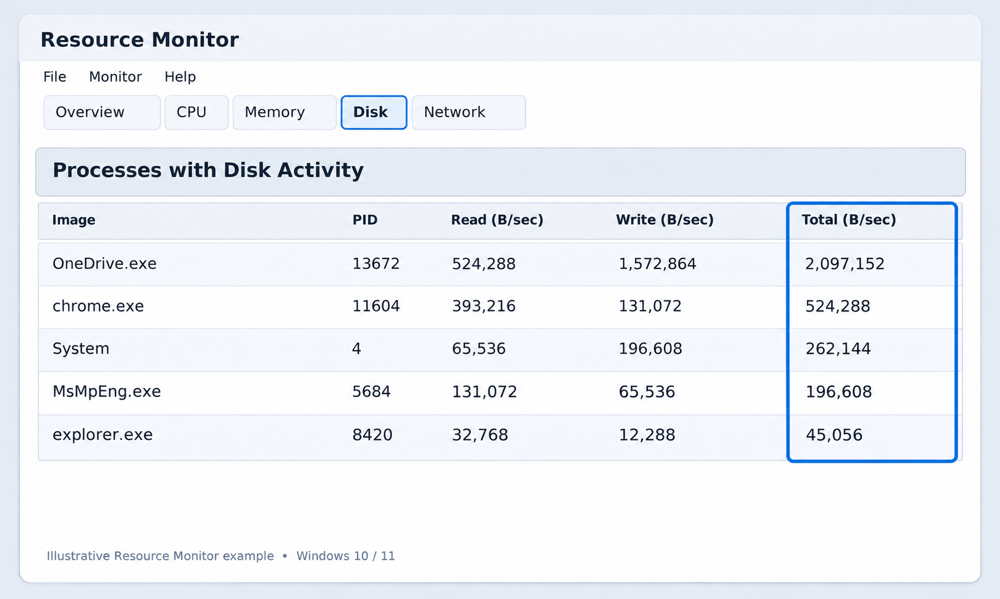
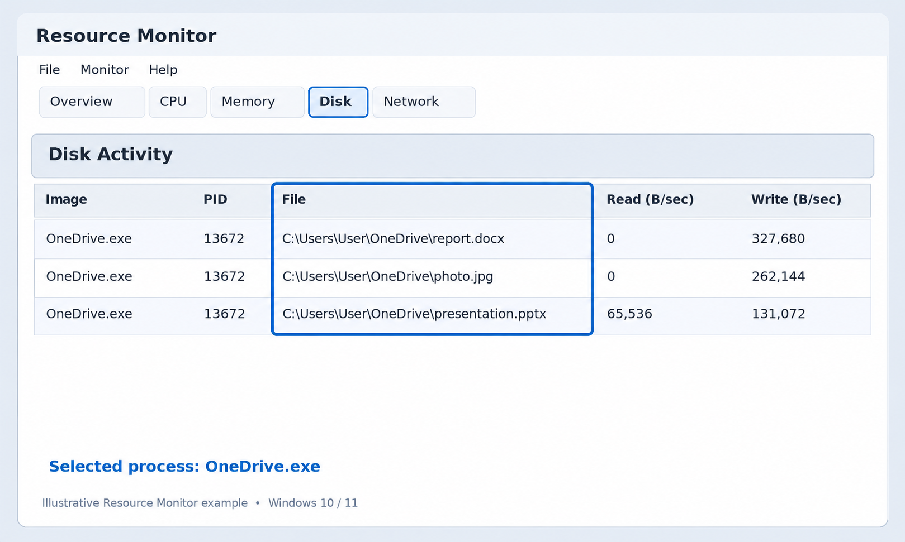
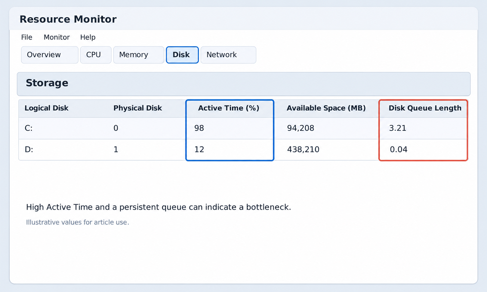

+++
title = "Коя програма товари диска и забавя Windows? Проверка с Resource Monitor"
slug = "resource-monitor-windows"
date = "2026-11-10T20:00:00.000+02:00"
author = "4s"
draft = false
description = "Компютърът работи бавно или дискът е на 100%? Вижте как с командата resmon да откриете кои програми и файлове натоварват HDD или SSD в Windows."
tags = ["Windows 11", "Windows 10", "Resource Monitor", "resmon", "Бавен компютър", "Натоварване на диск", "Диагностика", "SSD"]
coverImg = "main-photo.png"
+++
Компютърът работи бавно, програмите се отварят със закъснение, а в Task Manager дискът понякога показва 100% натоварване?

Причината може да е програма, която постоянно чете или записва файлове, автоматична актуализация или системен процес, работещ във фонов режим.

Windows разполага с вграден инструмент, наречен **Resource Monitor**, който показва какво точно се случва с диска в момента.

Можем да го отворим с една команда, без да инсталираме допълнителен софтуер.

### 1. Как да отворим Resource Monitor?

Натиснете **Win + R**, за да отворите прозореца Run.

Въведете командата:

`resmon`

Натиснете **Enter**.

Ще се отвори **Resource Monitor** – инструмент за наблюдение на процесора, оперативната памет, диска и мрежовата активност.

В горната част на прозореца ще видите разделите **Overview, CPU, Memory, Disk и Network**.

Изберете **Disk**.

Тук Windows показва кои процеси използват диска, кои файлове се четат или записват и колко е натоварено устройството.

### 2. Коя програма натоварва диска най-много?

В раздела Disk намерете таблицата **Processes with Disk Activity**.

Тя показва активните процеси, които извършват операции по четене и запис.

Обърнете внимание на следните колони:

| Показател     | Какво означава                    |
| ------------- | --------------------------------- |
| Image         | Име на процеса                    |
| PID           | Идентификационен номер на процеса |
| Read (B/sec)  | Средна скорост на четене          |
| Write (B/sec) | Средна скорост на запис           |
| Total (B/sec) | Обща скорост на четене и запис    |

Натиснете върху заглавието **Total (B/sec)**, за да подредите процесите по дискова активност.

Процесът с най-висока стойност извършва най-много операции по четене и запис за измервания период.

Например, ако браузърът изтегля голям файл, той може да се появи сред най-активните процеси.

Ако Windows инсталира актуализации, е възможно да видите висока активност от системни процеси.

**Важно:** Високата стойност сама по себе си не означава проблем. Трябва да проверим дали натоварването е продължително и дали съвпада със забавянето на компютъра.

### 3. Как да видим кои файлове използва програмата?

Това е една от най-полезните функции на Resource Monitor.

В таблицата **Processes with Disk Activity** поставете отметка пред програмата, която искате да проверите.

След това разгънете секцията **Disk Activity**, ако е затворена.

Тук можете да видите конкретните файлове, до които избраният процес осъществява достъп.

Например може да се показват пътища от типа:

`C:\Users\User\Downloads\video.mp4`

или:

`C:\Windows\SoftwareDistribution\Download\...`

Първият пример може да е свързан с изтегляне или обработка на файл.

Вторият може да показва активност, свързана с Windows Update.

Обърнете внимание и на колоната **Response Time (ms)**. Тя показва времето за обслужване на дисковите операции.

Ако дадена програма постоянно използва диска и времето за отговор е високо, това може да е следа към причината за забавянето.

Не изтривайте файлове само защото се появяват в Disk Activity. Много от тях са необходими за работата на Windows.

### 4. Как да проверим дали самият диск е претоварен?

В долната част на раздел Disk намерете секцията **Storage**.

Тя показва информация за активността на отделните устройства.

Особено полезни са следните показатели:

**Active Time (%)** – приблизителният процент от наблюдавания период, през който дискът е бил зает с операции.

**Disk Queue Length** – броят на дисковите заявки, които чакат или се обслужват.

Ако Active Time остава близо до 100% продължително време, а програмите реагират бавно, дискът може да е ограничението в производителността.

Но има важна подробност.

**100% Active Time не означава, че дискът е запълнен на 100%.**

Това са две различни неща.

Едното показва колко е зает дискът с операции, а другото – колко свободно пространство има.

При диагностика разглеждайте заедно активността, времето за отговор и дължината на опашката.

Няма универсална стойност на Disk Queue Length, която сама по себе си да доказва неизправност. Значението ѝ зависи от вида на устройството и натоварването.

### 5. Как да различим нормалната активност от проблем?

Не всяко натоварване на диска е необичайно.

Например при инсталиране на програма, копиране на големи файлове или актуализиране на Windows дискът може временно да бъде силно натоварен.

Това обикновено е очаквано поведение.

По-голямо внимание заслужават случаите, когато дискът остава зает продължително, без да извършвате тежка задача.

Например:

**Windows Update** – възможно е да изтегля или инсталира актуализации във фонов режим.

**Антивирусна програма** – може да извършва проверка на файловете.

**Облачна синхронизация** – приложения като OneDrive могат да качват и изтеглят файлове.

**Браузър** – множество отворени раздели, изтегляния или кеширане могат да предизвикват дискова активност.

За да установите дали има проблем, наблюдавайте процесите няколко минути и проверете дали активността намалява след приключване на съответната задача.

### 6. Какво да направим, ако открием натоварваща програма?

Ако установите, че определено приложение постоянно натоварва диска, първо проверете какво прави.

Ако извършва изтегляне, синхронизация или актуализация, може просто да изчакате задачата да приключи.

Ако програмата не реагира, опитайте да я затворите по нормалния начин.

Проверете и дали има налична актуализация за нея.

Ако натоварването е започнало след инсталиране на нов софтуер, можете временно да спрете автоматичното му стартиране и да проверите дали има подобрение.

**Не прекратявайте непознати системни процеси чрез End Process.** Това може да доведе до загуба на незапазена информация или нестабилност на Windows.

Ако дискът продължава да е необичайно бавен, дори при ниска активност, причината може да е в драйвера, недостатъчната оперативна памет или състоянието на самото устройство.

### Resource Monitor или Task Manager – кое да използваме?

И двата инструмента са вградени в Windows, но показват различно ниво на подробност.

| Task Manager                         | Resource Monitor                         |
| ------------------------------------ | ---------------------------------------- |
| Бърз преглед на натоварването        | По-подробна диагностика                  |
| Показва кои програми използват диска | Показва и конкретните използвани файлове |
| Подходящ за ежедневна проверка       | Подходящ за търсене на причината         |
| Отваря се с Ctrl + Shift + Esc       | Отваря се с resmon                       |

Ако искате само да видите дали дискът е натоварен, Task Manager обикновено е достатъчен.

Ако искате да разберете **коя програма и кои файлове причиняват активността**, Resource Monitor предоставя повече информация.

### Заключение

С командата `resmon` можете бързо да проверите какво натоварва диска в Windows 10 и 11.

Започнете от **Processes with Disk Activity**, подредете процесите по Total (B/sec) и разгледайте използваните файлове в **Disk Activity**.

След това проверете **Storage**, за да видите дали устройството е заето продължително.

Така ще можете да откриете причината за забавянето, без да изключвате системни услуги или да променяте настройки на случаен принцип.
