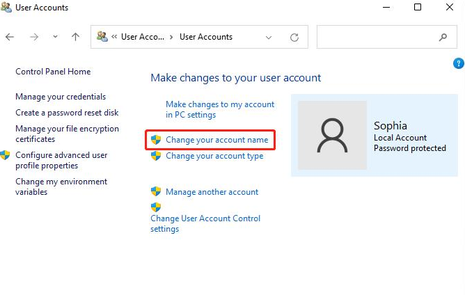
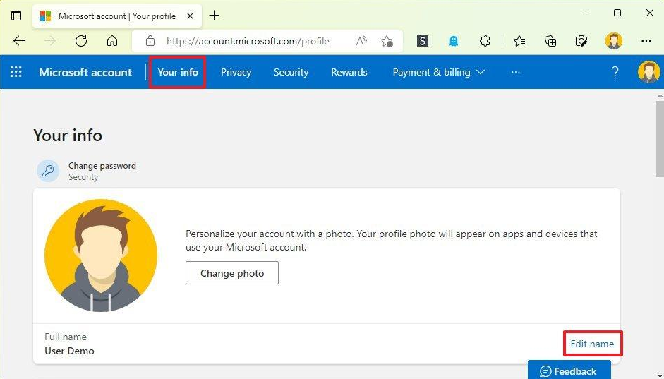

+++
title = "Как да сменим името на потребителския акаунт в Windows 11"
slug = "smyana-ime-potrebitel-windows-11"
date = "2026-10-31T21:53:00.000+02:00"
author = "4s"
draft = false
description = "Как да смените потребителското име в Windows 11? Инструкции за локален и Microsoft акаунт и обяснение защо папката C:\\Users не се преименува."
tags = ["Windows 11", "Потребителски акаунт", "Потребителско име", "Microsoft акаунт", "Локален акаунт"]
coverImg = "main-photo.png"
+++
Искате да промените името, което Windows показва при включване на компютъра или в менюто Start? Може би сте въвели грешно име при инсталацията или просто искате да използвате друго.

В Windows 11 това става сравнително лесно, но начинът зависи от това дали използвате **локален акаунт**, или **Microsoft акаунт**.

### Първо проверете какъв акаунт използвате

Натиснете **Win + I** и отворете:

**Settings → Accounts → Your info**

Ако виждате имейл адрес и информация за Microsoft акаунт, вероятно влизате с такъв.

Ако е посочено **Local account**, използвате локален акаунт, който съществува само на този компютър.

### Смяна на името на локален акаунт

При локален акаунт можем да променим показваното име директно от Control Panel.

1. Отворете **Start** и напишете `Control Panel`.
2. Изберете **User Accounts → User Accounts**.
3. Натиснете **Change your account name**.

   
4. Въведете новото име.
5. Потвърдете с **Change Name**.

Ако новото име не се появи веднага навсякъде, излезте от акаунта и влезте отново.

Тази промяна не изтрива файловете ви и не създава нов потребителски профил.

### Смяна на името при Microsoft акаунт

Ако влизате в Windows с имейл адрес и Microsoft акаунт, името се управлява през настройките на самия акаунт.

1. Отворете [account.microsoft.com](https://account.microsoft.com/).
2. Влезте с акаунта, който използвате в Windows.
3. Отворете **Your info (Вашата информация)**.
4. Изберете **Edit name (Редактиране на името)**.

   
5. Въведете новото име и запазете промените.

Имайте предвид, че промяната може да отнеме до 24 часа, докато се появи навсякъде.

Също така новото име може да се показва и в други услуги на Microsoft, които използват същия акаунт.

### Ще се промени ли името на папката в C:\Users?

Не. Това е една от най-честите причини за объркване.

Например, ако потребителската ви папка е:

`C:\Users\ivan`

и промените показваното име на **Георги**, папката обикновено ще продължи да се казва `ivan`.

Това е нормално. Windows използва този път за настройки, файлове и приложения, затова той не се променя автоматично заедно с името на акаунта.

**Не преименувайте папката ръчно от File Explorer.** Това може да доведе до проблеми със зареждането на профила или с работата на някои програми.

Ако искате и самата папка да има друго име, по-безопасният вариант обикновено е да създадете нов потребителски акаунт с желаното име и да прехвърлите необходимите файлове.

### А ако опцията за промяна на името липсва?

Първо проверете дали не използвате Microsoft акаунт, защото при него името се променя онлайн.

Ако компютърът е служебен или се управлява от организация, е възможно промяната да е ограничена от администратора.

В такъв случай не е необходимо да променяте системни настройки или Registry — най-добре се обърнете към човека, който управлява устройството.

### Накратко

Ако използвате **локален акаунт**, променете името през Control Panel.

Ако използвате **Microsoft акаунт**, направете промяната през страницата на Microsoft.

И в двата случая сменяте името, което се показва в Windows, а не името на потребителската папка в `C:\Users`.
