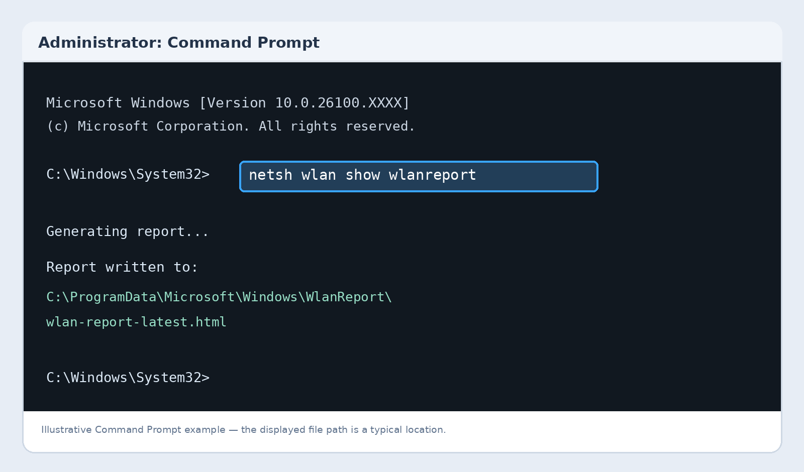
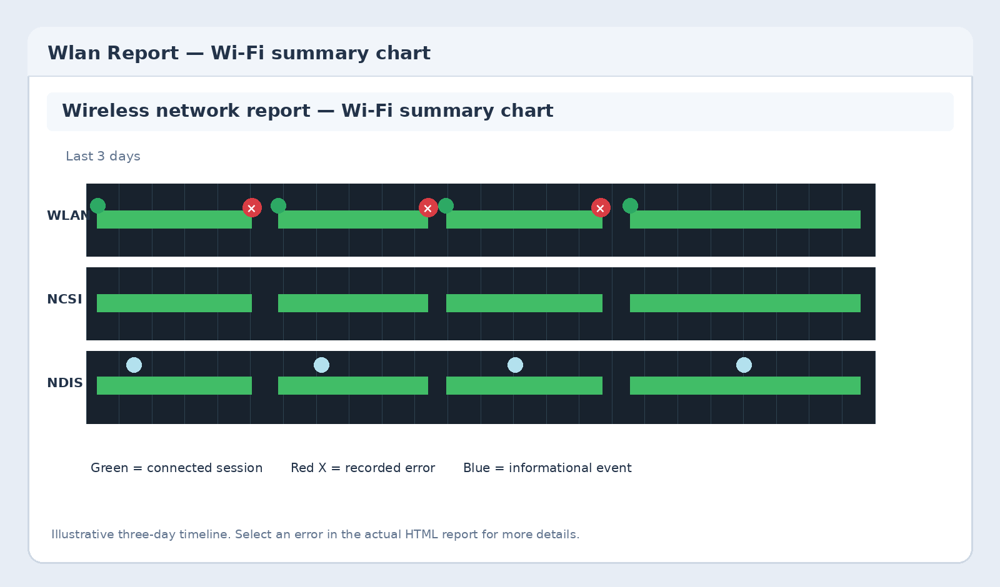
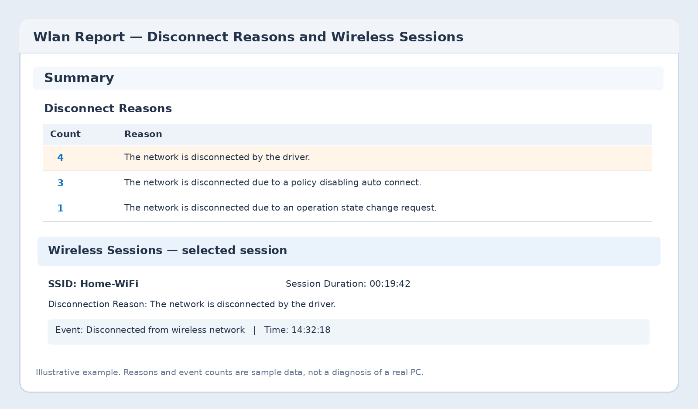

+++
title = "Wi-Fi прекъсва постоянно? Проверете причината с една команда"
slug = "wifi-prekasva-windows-wlanreport"
date = "2026-11-11T19:40:00.000+02:00"
author = "4s"
draft = true
description = "Wi-Fi връзката прекъсва в Windows 10 или 11? С командата netsh wlan show wlanreport проверете историята на свързванията, грешките и причините за прекъсване."
tags = ["Windows 11", "Windows 10", "Wi-Fi", "Безжична мрежа", "Диагностика", "netsh", "WLAN Report"]
coverImg = "main-photo.png"
+++
Wi-Fi връзката прекъсва за няколко секунди и след това се възстановява? Или лаптопът понякога отказва да се свърже с безжичната мрежа, без да показва ясна причина?

Windows разполага с вграден инструмент, който записва информация за безжичните връзки и може да ни помогне да открием кога и защо са възникнали прекъсвания.

С командата `netsh wlan show wlanreport` можем да създадем подробен отчет за последните три дни, без да инсталираме допълнителни програми.

### 1. Как да създадем отчет за Wi-Fi връзката?

Отворете менюто **Start** и потърсете **Command Prompt** или `cmd`.

Натиснете с десния бутон върху приложението и изберете **Run as administrator**.

Въведете командата:

`netsh wlan show wlanreport`

Натиснете **Enter**.

Windows ще събере наличните данни за безжичните връзки и ще създаде HTML отчет.

След приключване на командата ще видите съобщение с местоположението на файла.

Обикновено той се намира тук:

`C:\ProgramData\Microsoft\Windows\WlanReport\wlan-report-latest.html`

Командата е налична в Windows 10 и Windows 11.

### 2. Как да отворим и разчетем отчета?

Копирайте показания от Command Prompt адрес и го поставете в адресната лента на **File Explorer**.

Натиснете **Enter**.

Отчетът ще се отвори в браузъра ви.

В горната му част ще видите графика с историята на Wi-Fi връзките през последните три дни.

Тя съдържа информация за различните сесии на свързване, както и за регистрираните събития.

**Червените кръгове** обозначават грешки. Ако видите такъв символ, можете да го изберете, за да преминете към свързаната информация.

Можете също да изберете отделна част от графиката, за да разгледате съответната сесия.

Така ще установите приблизително кога е възникнал проблемът и към коя връзка се отнася.

### 3. Как да открием причините за прекъсване?

Превъртете надолу до раздела **Summary**.

Потърсете секцията **Disconnect Reasons**.

Тя обобщава регистрираните причини за прекъсване на безжичната връзка.

В зависимост от конкретния случай може да има събития, свързани с прекратена сесия, неуспешно удостоверяване или прекъсване на връзката с точката за достъп.

Отчетът не винаги показва една-единствена, категорична причина. Понякога събитието е само следа, която трябва да бъде проверена допълнително.

Особено полезно е да сравните часа на прекъсването с момента, в който действително сте забелязали проблема.

Например, ако Wi-Fi прекъсва всяка вечер, проверете дали отчетът показва повтарящи се събития по същото време.

### 4. Как да разгледаме конкретно прекъсване?

Намерете раздела **Wireless Sessions**.

Тук са описани отделните сесии на свързване към безжичните мрежи.

За всяка сесия може да откриете информация като:

| Показател            | Какво означава                       |
| -------------------- | ------------------------------------ |
| SSID                 | Името на Wi-Fi мрежата               |
| Connection Mode      | Как е установена връзката            |
| Session Duration     | Продължителност на сесията           |
| Disconnection Reason | Регистрирана причина за прекъсването |
| Events               | Събития, свързани със сесията        |

Ако изберете конкретно събитие, отчетът може да покаже допълнителни технически подробности.

Проверете дали прекъсванията се случват при свързване, по време на работа или след събуждане на лаптопа от Sleep.

Тези ситуации могат да имат различни причини.

### 5. Проверете информацията за Wi-Fi адаптера

В отчета има и раздел **Network adapters**.

Той съдържа информация за мрежовите адаптери на компютъра, включително модела и версията на драйвера.

Това е полезно, ако Wi-Fi е започнал да прекъсва след актуализация на Windows или инсталиране на нов драйвер.

Можете да направите допълнителна проверка и от Command Prompt:

`netsh wlan show drivers`

Командата показва информация за наличния безжичен драйвер и поддържаните функции.

Ако проблемът е започнал след конкретна актуализация, проверете сайта на производителя на лаптопа или Wi-Fi адаптера за подходящ драйвер.

Не инсталирайте произволни драйвери от непознати сайтове.

### 6. Какво да направим според резултатите?

След като откриете кога се появява прекъсването, можете да насочите проверките към конкретната ситуация.

**Връзката прекъсва само на едно място.** Проверете обхвата и дали между лаптопа и рутера има препятствия. Възможни са смущения или слаб сигнал.

**Проблемът възниква след Sleep.** Проверете дали има актуализация на драйвера за Wi-Fi адаптера и дали същото поведение се наблюдава след нормален рестарт.

**Свързването е неуспешно.** Разгледайте събитията за съответната сесия и проверете дали мрежовият профил и начинът на удостоверяване са правилни.

**Прекъсват всички устройства.** Вероятно трябва да насочите диагностиката към рутера, безжичната мрежа или интернет доставчика, вместо само към конкретния компютър.

Ако отчетът не показва прекъсване на Wi-Fi сесията, но страниците в браузъра не се зареждат, причината може да е свързана с интернет достъпа, DNS или друга част от мрежата.

При такъв случай вижте и нашето ръководство за Wi-Fi връзка без интернет.

### Какво още трябва да знаем за WLAN Report?

Отчетът показва събития за последните три дни, а не пълната история на всички Wi-Fi връзки от създаването на Windows.

Той може да съдържа имена на мрежи, данни за компютъра, потребителска информация и подробности за мрежовите адаптери.

Ако ще го изпращате на друг човек за диагностика, първо прегледайте съдържанието му.

Инструментът не променя настройките на Wi-Fi и не отстранява автоматично установените грешки.

### Заключение

Командата `netsh wlan show wlanreport` е удобен начин да проверите историята на Wi-Fi връзките в Windows 10 и 11.

Вместо да рестартирате рутера или да променяте настройки на случаен принцип, започнете с графиката, прегледайте **Disconnect Reasons** и разгледайте съответните записи в **Wireless Sessions**.

Така ще можете да разберете кога възниква прекъсването и кои настройки или устройства заслужават допълнителна проверка.
