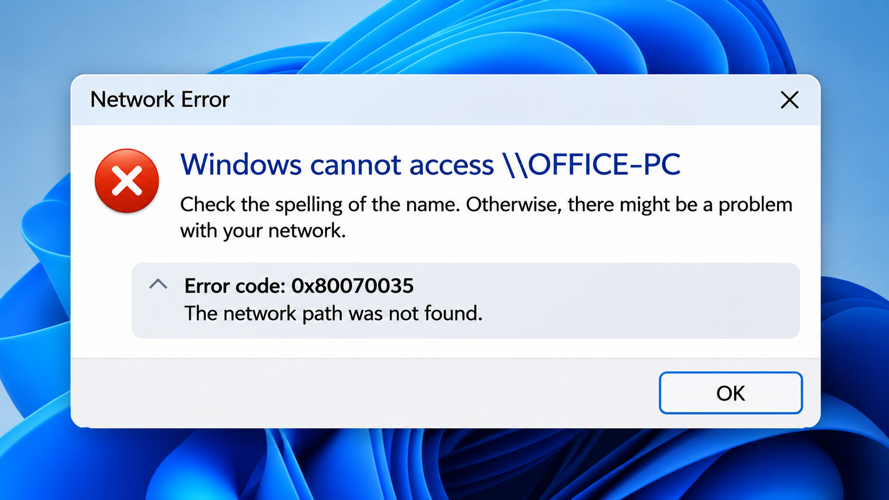
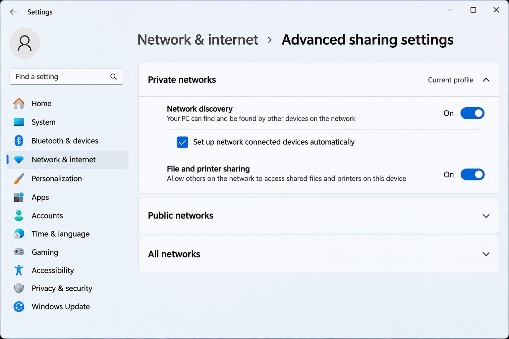
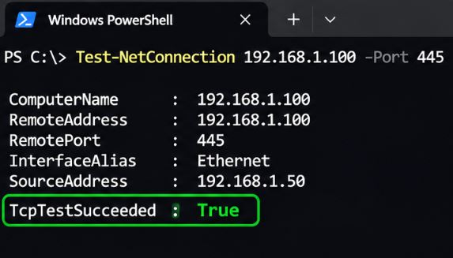
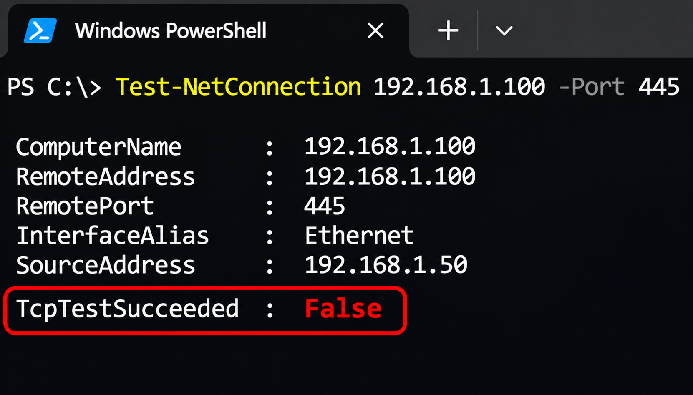

+++
title = "Грешка 0x80070035 в Windows – как да отворим споделена папка"
slug = "windows-error-0x80070035"
date = "2026-11-05T13:33:00.000+02:00"
author = "4s"
draft = false
description = "Windows показва грешка 0x80070035 при отваряне на споделена папка? Проверете мрежовата връзка, SMB, порт 445 и настройките за споделяне."
tags = ["Windows 11", "Windows 10", "Грешка 0x80070035", "Мрежа", "Споделени папки", "SMB"]
coverImg = "main-photo.png"
+++
При опит да отворите споделена папка от друг компютър Windows понякога показва съобщението **„Windows cannot access \ИмеНаКомпютър“** и код **0x80070035 – The network path was not found**.

Това означава, че Windows не успява да достигне посочения мрежов ресурс. Причината може да е неправилен адрес, мрежова настройка, защитна стена или проблем със SMB протокола.

Ето какво да проверите, преди да започнете да променяте системните настройки.

### 1. Проверете връзката с другия компютър

Уверете се, че компютърът, на който се намира споделената папка, е включен и свързан към мрежата.

Натиснете **Win + R**, въведете `cmd` и изпълнете:

Заменете адреса с IP адреса на другия компютър.

Ако не знаете IP адреса му, изпълнете `ipconfig` на него и потърсете **IPv4 Address**.

Ако получавате отговори от типа `Reply from...`, двата компютъра имат IP свързаност.

Ако виждате `Request timed out`, проверете адреса и мрежовата връзка. Имайте предвид, че някои защитни стени блокират ping заявките, дори когато компютърът е достъпен.

### 2. Опитайте да отворите папката чрез IP адрес

Понякога Windows не открива друг компютър по име, въпреки че връзката с него работи.

Отворете **File Explorer** и въведете в адресната лента:

Ако знаете името на споделената папка, можете да въведете пълния път:

Ако този адрес работи, но `\\IME-NA-PC` не се отваря, вероятно проблемът е свързан с разрешаването на мрежови имена.

Можете да направите допълнителна проверка:

Проверете дали името се преобразува в правилния IP адрес.

**Важно:** Достъпът чрез IP е полезен за диагностика, но в корпоративна среда с Kerberos е по-добре да се използва правилното DNS име на сървъра.

### 3. Проверете настройките за споделяне

В Windows 11 отворете:

**Settings → Network & internet → Advanced network settings → Advanced sharing settings**

В раздела **Private networks** проверете дали са включени:

* **Network discovery**
* **File and printer sharing**

  

Ако използвате доверена домашна или служебна мрежа, проверете и дали мрежовият профил е **Private**.

Network Discovery позволява устройствата да се откриват по-лесно в локалната мрежа. То обаче не е задължително условие за директен достъп до споделена папка чрез нейния адрес.

Не променяйте обществени или непознати мрежи на Private само заради тази грешка.

### 4. Проверете дали папката е споделена правилно

На компютъра, където се намира папката:

1. Натиснете с десния бутон върху папката и изберете **Properties**.
2. Отворете **Sharing → Advanced Sharing**.
3. Проверете дали **Share this folder** е включено.
4. Изберете **Permissions** и прегледайте разрешенията.

След това отворете раздел **Security** и проверете NTFS разрешенията.

За успешен достъп потребителят трябва да има необходимите права и на двете места.

Не е нужно да предоставяте **Full Control** на **Everyone**. По-добре е да разрешите достъп само на потребителите, които действително се нуждаят от него.

### 5. Проверете дали порт 445 е достъпен

Windows използва протокола **SMB (Server Message Block)** за достъп до споделени папки. При съвременните версии той обикновено използва TCP порт **445**.

Отворете PowerShell и изпълнете:

Потърсете резултата:

Ако стойността е **True**, TCP връзката към порт 445 е успешна.

Ако е **False**, причината може да е защитна стена, мрежово ограничение, неправилен IP адрес или недостъпна SMB услуга.

На компютъра, който споделя папката, проверете правилото **File and Printer Sharing (SMB-In)** в Windows Defender Firewall.

Не изключвайте цялата защитна стена.

Имайте предвид, че отворен порт 445 не гарантира, че удостоверяването и достъпът до папката ще бъдат успешни.

### 6. Проверете услугите за мрежово откриване

Ако компютърът не се появява в раздел **Network** на File Explorer, може да има проблем с откриването на устройства.

Натиснете **Win + R**, въведете:

Намерете услугите:

* **Function Discovery Provider Host**
* **Function Discovery Resource Publication**

Ако са спрени, проверете настройките им и при необходимост ги стартирайте. За постоянно мрежово откриване може да е необходим автоматичен тип на стартиране.

Тези услуги са свързани основно с откриването и показването на устройства в мрежата. Ако споделената папка се отваря директно чрез `\\IP-адрес`, не е необходимо да променяте настройките им само защото компютърът не се вижда в Network.

### 7. Проверете потребителското име и паролата

Някои споделени папки изискват потребителско име и парола от компютъра или сървъра, който предоставя достъпа.

При локален акаунт може да се използва форматът:

Ако Windows продължава да използва стари данни, отворете:

**Control Panel → Credential Manager → Windows Credentials**

Потърсете запис за съответния компютър или сървър.

Ако данните вече не са валидни, можете да ги редактирате или премахнете и да въведете правилните при следващото свързване.

### 8. Проверете SMB ограниченията в Windows 11 24H2

В Windows 11 24H2 Microsoft въведе по-строги настройки за сигурност при SMB връзките.

В изданията **Pro, Enterprise и Education** SMB подписването (*SMB signing*) се изисква по подразбиране както за входящите, така и за изходящите връзки.

Това може да създаде затруднения при свързване към по-стари NAS устройства, файлови сървъри и споделени папки, които използват незащитен гост достъп.

В някои случаи Windows показва грешка **0x80070035**.

Ако тя се е появила след актуализация, проверете дали отдалеченото устройство поддържа SMB подписване и удостоверяване с потребителско име и парола.

**Не изключвайте SMB signing и не активирайте SMB1 или insecure guest logons като универсално решение.** Това може да намали сигурността на компютъра.

По-добре е да актуализирате NAS устройството или файловия сървър и да използвате поддържан, защитен начин за достъп.

### Как да разберем къде е проблемът?

### Заключение

Грешката **0x80070035** невинаги означава, че споделената папка липсва.

Започнете с проверка на мрежовата връзка, опитайте директен достъп чрез IP адрес и тествайте порт 445. Ако те работят, насочете вниманието си към удостоверяването, разрешенията и SMB настройките.

Така ще установите по-лесно причината, без да изключвате важни функции за сигурност.

Какво установявамеКакво да проверимНяма връзка с IP адресаМрежова връзка, адрес, защитна стенаДостъпът чрез IP работи, но чрез име неDNS и разрешаване на именаTCP порт 445 е недостъпенSMB услуга, защитна стена, мрежово ограничениеWindows иска потребителско име и паролаУдостоверяванеПоявява се Access deniedРазрешения и потребителски праваГрешката се появява след актуализацияSMB изисквания и съвместимост
