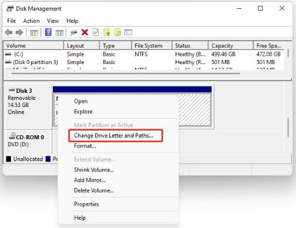
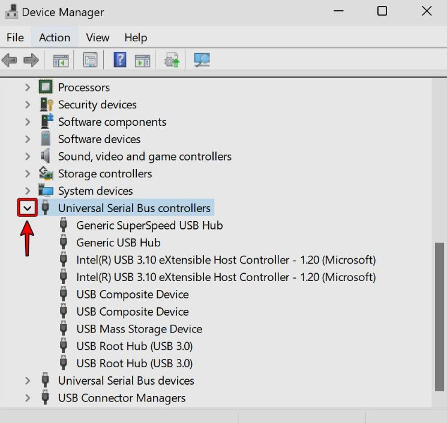

+++
title = "Windows не разпознава USB флашката – какво да проверим?"
slug = "windows-ne-razpoznava-usb"
date = "2026-10-29T12:13:00.000+02:00"
author = "4s"
draft = true
description = "Windows 10 или 11 не разпознава USB флашка? Вижте 6 лесни проверки за USB портовете, Disk Management и драйверите, без да рискувате файловете си."
tags = ["USB", "Флашка", "Windows 11", "Windows 10", "USB device not recognized", "Disk Management"]
coverImg = "thumb-flash.png"
+++
Включвате USB флашката в компютъра, но нищо не се случва? Тя не се появява в „Този компютър“, а понякога Windows дори показва съобщението „USB device not recognized“.

Това не означава непременно, че флашката е повредена. Причината може да е в USB порта, настройките на Windows, драйвера или начина, по който системата разпознава устройството.

Преди да се отказвате от флашката, опитайте следните проверки.

**Важно:** Ако имате ценни файлове на нея, не избирайте Format, Initialize или Delete Volume. Тези действия могат да доведат до загуба на данни.

## 1. Опитайте друг USB порт

Започнете с най-лесното. Извадете флашката и я включете в друг USB порт на компютъра.

Ако използвате настолен компютър, опитайте някой от портовете от задната страна на кутията. Те обикновено са свързани директно към дънната платка.

Ако флашката е включена през USB хъб или удължител, свържете я директно към компютъра.

Понякога проблемът се оказва само в конкретния порт или в междинното устройство.

## 2. Проверете флашката на друг компютър

Ако Windows продължава да не я разпознава, опитайте да я включите в друг компютър.

Ако там работи нормално, вероятно проблемът е в настройките, драйверите или USB портовете на първия компютър.

Ако не работи никъде, е възможно самата флашка да е повредена.

Ако съдържа важни данни, не правете опити за форматиране.

## 3. Проверете дали флашката се вижда в Disk Management

Понякога Windows открива USB устройството, но то не се показва във File Explorer.

Натиснете **Win + X** и изберете **Disk Management (Управление на дискове)**.

Можете също да натиснете **Win + R**, да въведете `diskmgmt.msc` и да натиснете Enter.

Потърсете флашката в списъка с дискове. Ще я разпознаете по капацитета ѝ, например 16 GB, 32 GB или 64 GB.

Ако се показва като **Online** и има дял със статус **Healthy**, но липсва буква като D:, E: или F:, може да е достатъчно да ѝ зададете такава.

Натиснете с десния бутон върху дяла и изберете:

**Change Drive Letter and Paths → Add**

Изберете свободна буква и потвърдете с **OK**.

След това проверете дали флашката вече се появява във File Explorer.

**Внимание:** Ако дискът се показва като RAW, Unallocated или Not Initialized, не го форматирайте и не създавайте нов дял, ако на него има файлове, които искате да запазите.

## 4. Проверете устройството в Device Manager

Ако флашката все още не работи, проверете дали Windows я открива като USB устройство.

1. Натиснете **Win + X** и отворете **Device Manager**.
2. Разгънете **Disk drives** и **Universal Serial Bus controllers**.
3. Потърсете флашката или устройство с жълт предупредителен знак.

Ако виждате такъв знак, отворете **Properties → General** и проверете съобщението в **Device status**.

Там може да има код за грешка, който да помогне за установяване на причината.

Можете да опитате и **Action → Scan for hardware changes**, за да накарате Windows да провери отново свързаните устройства.

## 5. Проверете драйвера на USB устройството

Ако Device Manager показва проблем с устройството, натиснете с десния бутон върху него и изберете:

**Update driver → Search automatically for drivers**

Windows ще провери дали има подходящ драйвер.

Ако проблемът е започнал след актуализация, можете да проверите и дали е налична опцията **Roll Back Driver** в свойствата на устройството.

Не изтегляйте случайни „USB driver repair“ програми от интернет. За драйвери използвайте Windows Update или официалния сайт на производителя.

## 6. Рестартирайте компютъра

Ако нито една от проверките не е помогнала, извадете флашката и рестартирайте Windows.

След като компютърът се зареди напълно, включете устройството отново и проверете дали се появява във File Explorer.

Понякога рестартирането е достатъчно, когато проблемът е причинен от временно състояние на USB контролера или драйвера.

## А ако флашката все още не се разпознава?

Ако устройството не работи и на друг компютър, вероятността за хардуерен проблем е по-голяма.

Ако се появява в Disk Management, но Windows предлага да го форматирате, не бързайте да се съгласявате. Възможно е файловата система да е повредена.

**Ако файловете са важни, първо помислете за възстановяване на данните.** Форматирането не е подходяща първа стъпка.

В много случаи проблемът е в порта, драйвера или липсваща буква на устройството. Затова винаги започвайте с най-простите проверки, преди да правите промени по диска.
