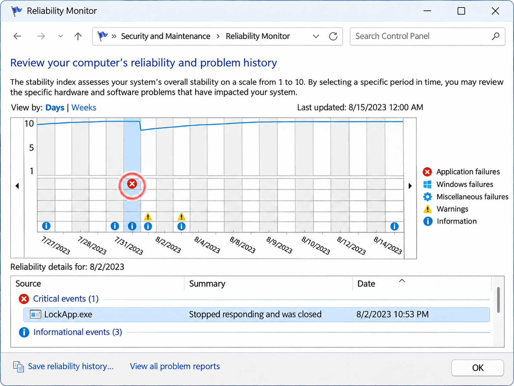
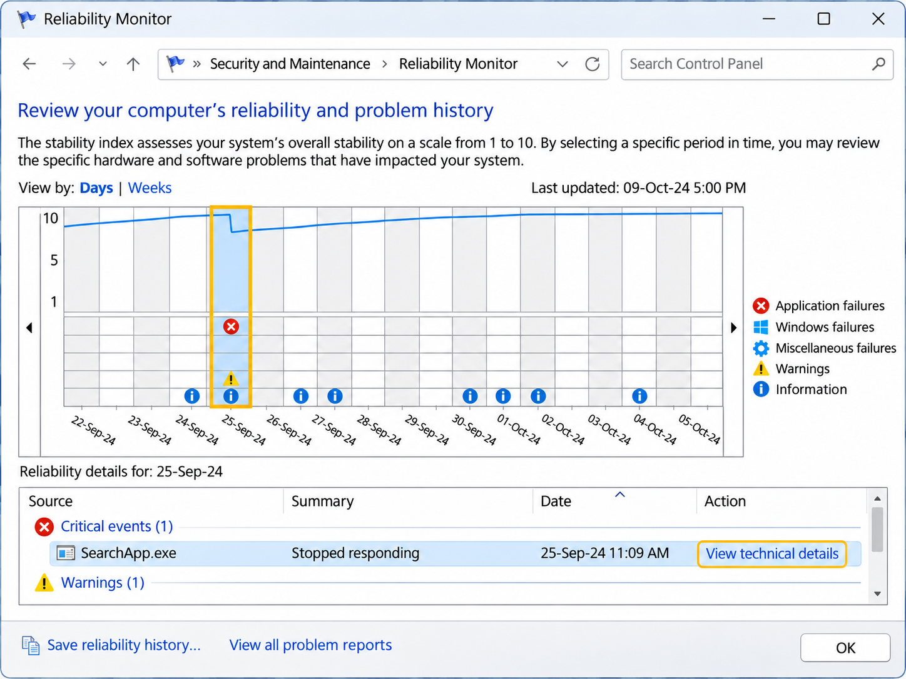
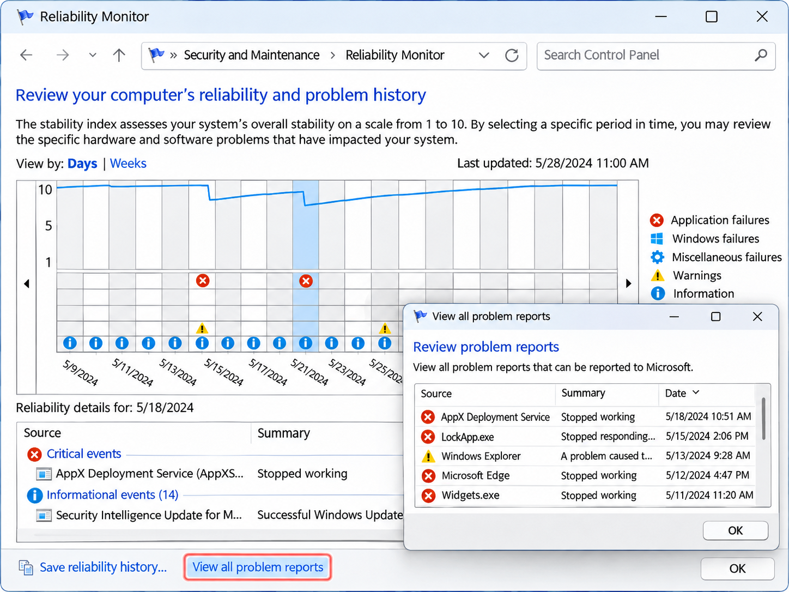

+++
title = "Как да видим историята на грешките в Windows с една команда"
slug = "windows-reliability-monitor"
date = "2026-11-08T21:10:00.000+02:00"
author = "4s"
draft = true
description = "Научете как да видите историята на грешките в Windows 10 и 11 с командата perfmon /rel. Проверете сривове на програми, системни грешки и актуализации."
tags = ["Windows 11", "Windows 10", "Reliability Monitor", "Грешки в Windows", "Диагностика", "perfmon", "Системни инструменти"]
coverImg = "main-photo.png"
+++
Случвало ли ви се е някоя програма да спре да работи, компютърът да забие или Windows да се рестартира неочаквано, без да разберете причината?

Windows разполага с вграден инструмент, който пази история на редица системни грешки, сривове на приложения и промени по компютъра.

Той се нарича **Reliability Monitor** и може да бъде отворен само с една команда, без да инсталирате допълнителен софтуер.

### 1. Как да отворим Reliability Monitor?

Натиснете **Win + R**, за да отворите прозореца Run.

Въведете командата:

`perfmon /rel`

Натиснете **Enter**.

Ще се отвори прозорец с име **Reliability Monitor**, който показва историята на надеждността и грешките в Windows.

Инструментът е наличен както в Windows 10, така и в Windows 11.

### 2. Как да разчитаме графиката?

В горната част на прозореца ще видите графика, която показва стабилността на системата през определен период.

Windows изчислява показател, наречен **Stability Index**, със стойности от 1 до 10, като по-високата стойност означава по-добра отчетена стабилност.

Под графиката се показват различни събития, обозначени със символи.

| Символ                          | Значение                                    |
| ------------------------------- | ------------------------------------------- |
| Червен кръг с X                 | Критично събитие, например срив на програма |
| Жълт предупредителен триъгълник | Предупреждение                              |
| Син информационен символ        | Информация за промяна или събитие           |

Например, ако дадена програма е спряла да работи, може да видите червен символ в деня, когато това се е случило.

Можете да превключвате изгледа между **Days** (дни) и **Weeks** (седмици).

### 3. Как да видим подробности за конкретна грешка?

Натиснете върху датата, която ви интересува.

В долната част на прозореца ще се появи списък със събитията за избрания период.

Те могат да включват:

* **Application failures** – сривове на приложения.
* **Windows failures** – грешки на операционната система.
* **Miscellaneous failures** – други регистрирани неизправности.
* **Warnings** – предупреждения.
* **Information** – информация за актуализации, инсталации и други промени.

Намерете интересуващото ви събитие и изберете **View technical details**, ако тази опция е налична.

Ще се отвори прозорец с допълнителна информация.

В зависимост от грешката може да видите името на приложението, вида на проблема, модула, в който е възникнал сривът, или технически код.

Тази информация е полезна, когато търсите решение за конкретна грешка.

### 4. Как да разберем кога е започнал проблемът?

Едно от най-полезните приложения на Reliability Monitor е да сравняваме грешките с промените по компютъра.

Например:

В понеделник сте инсталирали нов драйвер за видеокартата.

Във вторник дадена програма е започнала да забива.

Отваряте Reliability Monitor и виждате, че преди инсталацията на драйвера няма регистрирани сривове, а след нея те се повтарят.

Това не доказва, че драйверът е причината, но е добра отправна точка за проверка.

По същия начин можете да проверите дали проблем е започнал след актуализация на Windows или инсталиране на нова програма.

**Важно:** Не всяка промяна, отбелязана в Reliability Monitor, е причина за появилата се грешка. Сравнявайте датите и търсете повтарящи се събития.

### 5. Как да видим всички регистрирани проблеми?

В долната част на Reliability Monitor ще намерите опцията **View all problem reports**.

Тя отваря списък с наличните отчети за проблеми.

Така можете по-лесно да откриете дали определено приложение се е сривало многократно.

Ако искате да запазите историята, използвайте **Save reliability history**.

Windows ще ви предложи да запишете информацията в XML файл.

Това е полезно, ако ще анализирате проблема по-късно или ще изпращате информация на техническа поддръжка.

Имайте предвид, че отчетът може да съдържа имена на приложения и друга информация за компютъра. Прегледайте го, преди да го споделите.

### 6. Какво да направим, ако открием грешка?

Reliability Monitor е диагностичен инструмент. Той не поправя автоматично откритите проблеми.

Ако установите, че определена програма се срива многократно, можете да:

1. Проверите дали има нова версия на приложението.
2. Потърсите информация за конкретната грешка или посочения модул.
3. Проверите дали проблемът е започнал след актуализация.
4. Разгледате съответните записи в Event Viewer, ако е необходима по-подробна диагностика.

За да отворите Event Viewer, натиснете **Win + R** и въведете:

`eventvwr.msc`

Там можете да потърсите допълнителни системни записи за същия период.

Не премахвайте драйвери и не променяйте системни настройки само въз основа на един запис в Reliability Monitor.

### Каква е разликата между Reliability Monitor и Event Viewer?

И двата инструмента помагат при диагностика на Windows, но имат различно предназначение.

| Reliability Monitor                 | Event Viewer                                 |
| ----------------------------------- | -------------------------------------------- |
| Показва историята в удобна графика  | Показва подробни системни журнали            |
| Подходящ за бърз преглед на сривове | Подходящ за по-задълбочена диагностика       |
| Позволява лесно сравнение по дати   | Предоставя филтриране по събития и източници |
| По-лесен за начинаещи               | Съдържа повече техническа информация         |

Ако просто искате да разберете кога дадена програма е започнала да забива, Reliability Monitor обикновено е по-удобната отправна точка.

Ако вече търсите конкретно системно събитие или код на грешка, Event Viewer може да предостави повече подробности.

### Заключение

С командата `perfmon /rel` можете за секунди да отворите историята на надеждността на Windows и да проверите кога са възникнали сривове, грешки или промени по системата.

Инструментът е особено полезен, когато даден проблем се появява периодично и не знаете кога точно е започнал.

Вместо веднага да преинсталирате програми или да променяте настройки, първо разгледайте историята. Понякога тя дава най-добрата следа към причината.
