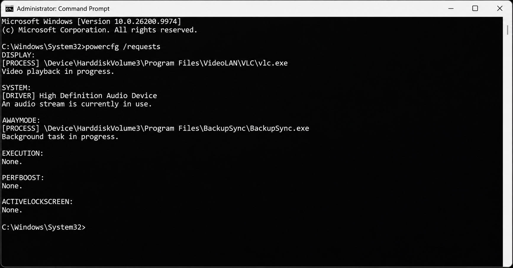
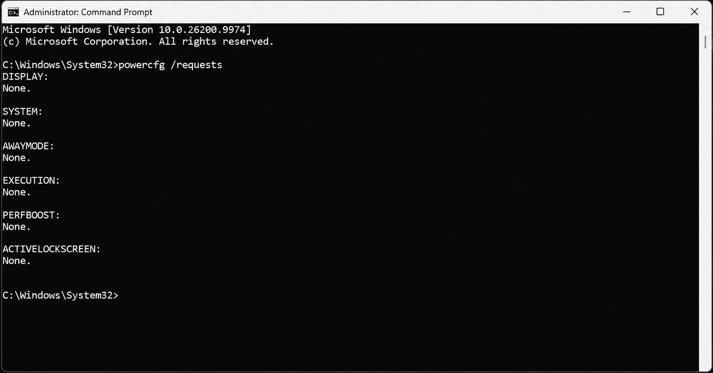

+++
title = "Компютърът не влиза в Sleep? Вижте коя програма го задържа"
slug = "windows-sleep-powercfg-requests"
date = "2026-11-13T15:45:00.000+02:00"
author = "4s"
draft = false
description = "Windows 10 или 11 не влиза автоматично в Sleep? Вижте как с командата powercfg /requests да проверите кои програми и драйвери задържат компютъра активен."
tags = ["Windows 11", "Windows 10", "Sleep", "powercfg", "Захранване", "Диагностика", "Command Prompt"]
coverImg = "green-waves-and-sleep-requests.png"
+++
Случвало ли ви се е да оставите компютъра включен, но той да не влиза автоматично в Sleep, въпреки че сте задали време за заспиване?

Причината понякога е програма или драйвер, който подава заявка Windows да остане активен.

С една вградена команда можем да проверим дали в момента има такива заявки, без да инсталираме допълнителен софтуер.

### 1. Как да проверим какво задържа компютъра активен?

Отворете менюто **Start** и потърсете **Command Prompt** или `cmd`.

Изберете **Run as administrator**.

Въведете следната команда:

`powercfg /requests`

Натиснете **Enter**.

Windows ще покаже списък с активните заявки за захранване от приложения, услуги и драйвери.

Командата работи в Windows 10 и Windows 11 и не променя никакви настройки.

### 2. Как да разчетем резултатите?

В прозореца ще видите няколко категории. Най-важните за нашата проверка са:

| Категория | Какво показва                              |
| --------- | ------------------------------------------ |
| DISPLAY   | Заявки екранът да остане включен           |
| SYSTEM    | Заявки системата да не заспива автоматично |
| AWAYMODE  | Заявки за специалния режим Away Mode       |

Например под **SYSTEM** може да се появи приложение, което възпроизвежда мултимедия, или драйвер, който поддържа активна системата.

Ако под дадена категория пише **None**, в момента няма отчетена активна заявка от този тип.

Това обаче не гарантира, че компютърът непременно ще заспи. Възможно е причината да е друга настройка или системно състояние.

### 3. Какво да направим, ако открием програма?

Ако командата показва конкретно приложение, проверете дали то изпълнява задача – например възпроизвежда видео, работи с аудио или извършва операция във фонов режим.

Затворете приложението по нормалния начин, ако не ви е необходимо.

След това изпълнете отново:

`powercfg /requests`

Ако съответната заявка изчезне, проверете дали компютърът вече влиза автоматично в Sleep след зададеното време.

Не прекратявайте непознати системни процеси и не изключвайте драйвери само защото се появяват в резултатите.

### 4. А ако всички категории показват None?

Тогава командата не открива активни заявки в момента на проверката.

Проверете времето за автоматично заспиване в:

**Windows 11:** Settings → System → Power & battery → Screen, sleep & hibernate timeouts

**Windows 10:** Settings → System → Power & sleep

Имената на настройките може да се различават според версията и устройството.

Ако компютърът влиза в Sleep, но след това се събужда сам, можете да проверите последния регистриран източник на събуждане с командата:

`powercfg /lastwake`

Имайте предвид, че тя може да не установи причината във всеки случай.

### Заключение

Командата `powercfg /requests` е бърз начин да проверите дали приложение или драйвер пречи на Windows да изключи автоматично екрана или да премине в Sleep.

Тя показва активните заявки към момента на изпълнението, затова е най-полезно да я стартирате, докато проблемът се проявява.

Ако откриете конкретно приложение, започнете с проверка на неговата дейност, вместо да променяте системните настройки на случаен принцип.
