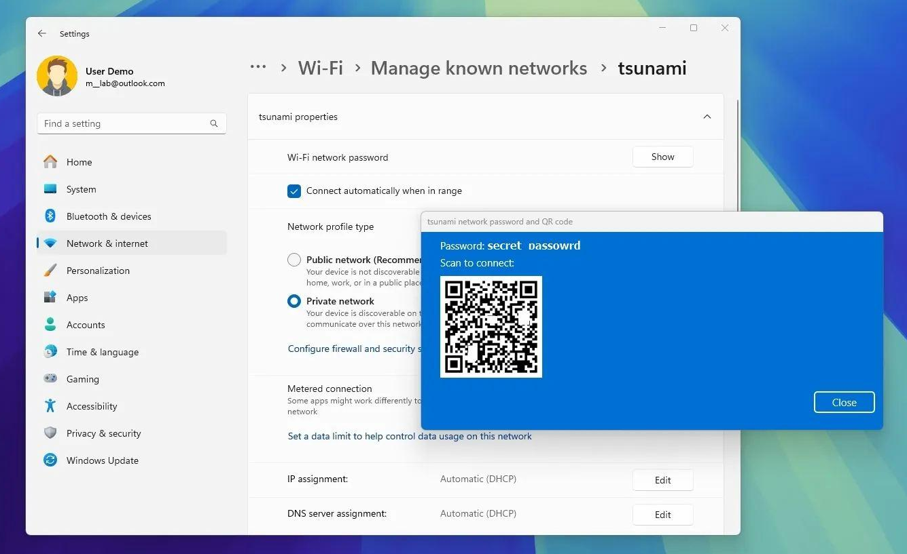
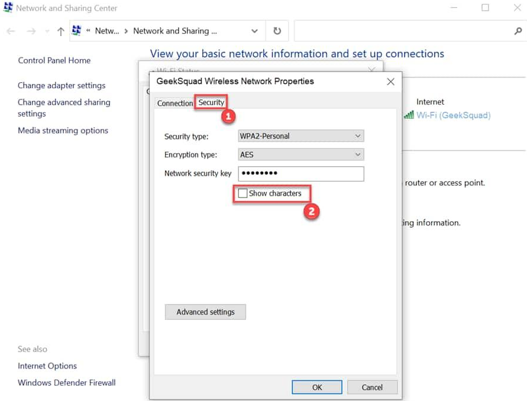

+++
title = "Забравена Wi-Fi парола? Ето къде да я намерите в Windows"
slug = "zapazena-wifi-parola-windows"
date = "2026-11-01T14:25:00.000+02:00"
author = "4s"
draft = false
description = "Забравили сте Wi-Fi паролата? Вижте как да намерите запазената парола в Windows 11 и Windows 10, включително за мрежи, използвани преди."
tags = ["Wi-Fi", "Wi-Fi парола", "Windows 11", "Windows 10", "Безжична мрежа", "Мрежови настройки"]
coverImg = "main-photo.png"
+++
Трябва да свържете телефона или друг компютър към домашния Wi-Fi, но не помните паролата? Ако вашият компютър вече се е свързвал към тази мрежа, има голяма вероятност Windows да я е запазил.

Не е необходимо да сменяте паролата на рутера или да инсталирате допълнителни програми. Можете да я проверите направо от настройките на Windows.

### Как да видите Wi-Fi паролата в Windows 11

В актуалните версии на Windows 11 това става директно от настройките.

1. Натиснете **Win + I**, за да отворите Settings.
2. Изберете **Network & internet → Wi-Fi**.
3. Отворете свойствата на мрежата, към която сте свързани.
4. Намерете **Wi-Fi network password** и натиснете **Show**.

   

Windows ще покаже запазената парола. В зависимост от версията може да се появи и QR код, с който да свържете друго устройство, без да въвеждате паролата ръчно.

### Как да видите парола за стара Wi-Fi мрежа

Ако вече не сте свързани към мрежата, но сте я използвали преди, Windows 11 може да пази нейните настройки.

Отворете:

**Settings → Network & internet → Wi-Fi → Manage known networks**

Изберете желаната мрежа и потърсете **Wi-Fi network password → Show**.

Това е удобно, ако например искате да си припомните паролата на домашната мрежа, докато сте свързани към друга.

Ако мрежата е премахната с **Forget**, паролата ѝ вече няма да е достъпна по този начин.

### Как да намерите Wi-Fi паролата в Windows 10

При Windows 10 процедурата е малко по-различна.

1. Отворете **Settings → Network & Internet → Status**.
2. Изберете **Network and Sharing Center**.
3. До **Connections** натиснете името на активната Wi-Fi мрежа.
4. В появилия се прозорец изберете **Wireless Properties**.
5. Отворете раздела **Security**.
6. Поставете отметка на **Show characters**.

   

Паролата ще се покаже в полето **Network security key**.

Този начин е подходящ, когато компютърът е свързан към съответната безжична мрежа.

### А ако не намирате паролата?

Ако Windows не пази настройките на мрежата или не предлага опция за показване на паролата, проверете етикета на рутера.

При някои рутери фабричната Wi-Fi парола е отпечатана върху самото устройство. Имайте предвид, че тя няма да е актуална, ако е била променяна.

Друг вариант е да проверите настройките на рутера, ако имате администраторски достъп до него.

### Накратко

В Windows 11 най-лесно ще намерите запазената Wi-Fi парола през **Settings → Network & internet → Wi-Fi**.

При Windows 10 можете да я видите през **Network and Sharing Center → Wireless Properties → Security**.

Не забравяйте, че Wi-Fi паролата дава достъп до безжичната мрежа. Споделяйте я само с хора, на които имате доверие.
