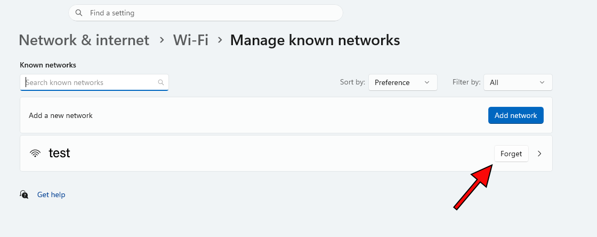

+++
title = "Имате Wi-Fi, но нямате интернет? 6 лесни стъпки"
date = "2026-10-19T16:46:00.000+03:00"
author = "4s"
draft = false
coverImg = "main.png"
+++
Случвало ли ви се е компютърът да показва, че сте свързани към Wi-Fi, но когато отворите браузъра, нищо да не зарежда?

Това е доста често срещан проблем и невинаги означава, че интернетът е спрян. Понякога причината е в рутера, друг път в настройките на Windows.

Преди да звъните на интернет доставчика, опитайте следните решения.

## 1. Проверете дали интернетът работи на телефона

Първо трябва да разберем дали проблемът е само при компютъра.

Изключете мобилните данни, свържете телефона си към същата Wi-Fi мрежа и опитайте да отворите произволен сайт.

Ако и на телефона няма интернет, най-вероятно проблемът е в рутера или при доставчика. Ако телефонът работи нормално, продължете със следващите стъпки.

## 2. Рестартирайте рутера

Колкото и банално да звучи, обикновеното рестартиране понякога е напълно достатъчно.

Изключете рутера от контакта, изчакайте около 20 секунди и го включете отново. След това му дайте няколко минути да възстанови връзката.

Не натискайте малкия бутон **RESET**, защото той може да изтрие настройките на рутера.

## 3. Изключете Wi-Fi и го включете отново

Ако интернетът работи на телефона, но не и на компютъра, опитайте да прекъснете безжичната връзка.

Натиснете иконата за мрежата до часовника в Windows, изключете Wi-Fi за няколко секунди и го включете отново.

Свържете се към вашата мрежа и проверете дали сайтовете вече се отварят.

## 4. Накарайте Windows да забрави мрежата

Понякога Windows запазва настройки за дадена Wi-Fi мрежа, които създават проблем при следващо свързване.

Можете да изтриете запазената връзка и да я създадете отново.

В Windows 11 отворете:

**Settings → Network & Internet → Wi-Fi → Manage known networks**





Намерете вашата мрежа и натиснете **Forget (Забрави)**.

След това се свържете отново и въведете паролата за Wi-Fi. Уверете се, че я знаете, преди да премахнете мрежата.

## 5. Изчистете DNS кеша

Ако някои сайтове не се отварят, а други работят, възможно е причината да е в DNS кеша.

Windows пази информация за адресите на посещаваните сайтове, за да ги намира по-бързо. Понякога тази информация може да е остаряла.

За да я изчистите:

1. Отворете **Start** и напишете `cmd`.
2. Натиснете с десния бутон върху **Command Prompt** и изберете **Run as administrator**.
3. В появилия се прозорец въведете:

   ```cmd
   ipconfig /flushdns
   ```
4. Натиснете **Enter**.

След като командата приключи, опитайте да отворите сайта отново.

Тази стъпка може да помогне, когато проблемът е свързан със запазен DNS запис.

## 6. Оставете Windows да провери за проблем

Ако нищо дотук не е помогнало, използвайте вградения инструмент за диагностика.

В Windows 11 отворете **Start**, потърсете приложението **Get Help** и въведете **Network and Internet troubleshooter**.

Следвайте указанията. Windows ще направи няколко проверки и може да открие причината за проблема.

## Все още нямате интернет?

Рестартирайте компютъра и проверете дали интернет доставчикът няма временно прекъсване.

Ако всички останали устройства имат интернет, а компютърът продължава да няма, вероятно ще трябва да се проверят мрежовият адаптер, драйверът му или IP и DNS настройките.

Не е необходимо веднага да преинсталирате Windows или да връщате рутера към фабричните настройки. По-добре е първо да установите откъде идва проблемът.
